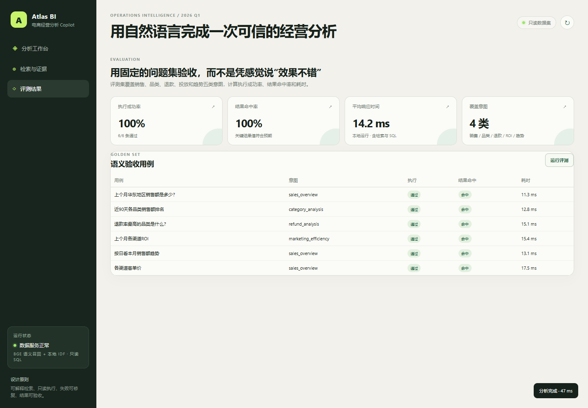

# Atlas BI · 电商经营分析 Copilot

一个面向运营/商分人员的 NL2SQL 数据工作台：把自然语言问题转换成只读 SQL，展示查询结果、图表、SQL、Schema 召回依据和失败修复轨迹。


## 为什么不是普通“企业问答助手”

泛化的企业问答容易变成“文档检索 + 聊天框”，招聘方很难判断真实工程能力。这个项目选择了更具体的业务域：

- 用户：电商运营 / 商业分析
- 数据：订单、商品行、退款、渠道投放、客户画像
- 问题：销售额、品类、退款率、ROI、客单价、趋势
- 工程约束：只读 SQL、敏感字段拦截、结果可解释、可做离线评测

## 已实现能力

| 模块 | 实现 |
| --- | --- |
| 双路召回 | Qdrant + BGE 中文向量召回 + 关键词召回；配置 Elasticsearch 时以 BM25 得分参与融合，否则回退本地 IDF |
| 查询规划 | 识别销售/品类/退款/投放/趋势意图与时间、地区、渠道筛选 |
| SQL 生成 | 离线规则生成器；配置 OpenAI 后切换 LLM 生成 |
| 执行安全 | sqlglot AST 校验、单条 SELECT、表白名单、函数白名单、敏感字段拦截 |
| SQL 自愈 | LangGraph 状态机，执行失败后把错误、原 SQL 与 Schema 反馈给 LLM 修复；LLM 不可用时回退规则 SQL，默认最多 2 次 |
| 结果展示 | 指标卡、图表、结果表、SQL 面板、召回分数、执行轨迹 |
| 离线评测 | 6 条黄金用例，计算执行成功率、结果命中率和平均耗时 |
| 可复现数据 | 固定随机种子生成 2025-10 到 2026-02 的电商数据 |

## 快速启动

要求 Python 3.10+，CI 使用 Python 3.12 验证。

```bash
python -m pip install -r requirements.txt
python -m app.nl2sql.seed
python -m uvicorn app.api.main:app --reload --port 8000
```

Windows 可直接运行 `run.ps1`，macOS / Linux 运行 `./run.sh`。打开 http://localhost:8000 。

默认会在首次启动时下载 `BAAI/bge-small-zh-v1.5`，网络较慢时首屏和首次查询会明显变久；只需下载一次。Qdrant 默认使用内存模式，应用每次启动时重建 5 张表的向量索引；设置 `QDRANT_URL` 后连接远端实例。Elasticsearch 是可选适配器，未配置时关键词召回使用本地 IDF。

## 开启真实 LLM

复制 `.env.example` 为 `.env`，填入：

```env
LLM_ENABLED=true
OPENAI_API_KEY=your_key
LLM_MODEL=gpt-4.1-mini
```

无论生成器是否使用 LLM，最终 SQL 都必须经过同一个 AST 安全门禁。

## 评测

```bash
python -m pip install -r requirements-dev.txt
python -m pytest -q
python -m app.evaluation.run
```

最近一次本地评测结果：**6/6 用例命中，SQL 执行成功率 100%**；首次加载 BGE 后完整评测平均约 **344 ms**，预热后的单次查询约 **9–31 ms**。该数字来自当前机器和当前数据集，不是行业基准；CI 使用 `USE_BGE=false` 做不依赖模型下载的快速回归。



## 目录

```text
app/
  api/main.py          FastAPI 接口
  nl2sql/
    retrieval.py       双路 Schema 检索
    planner.py         查询意图与筛选条件
    generator.py       规则 / LLM SQL 生成
    sql_engine.py      AST 安全校验与只读执行
    workflow.py        LangGraph 自愈工作流
    evaluation.py      黄金评测集
  static/              前端工作台
tests/                 单元、API 与端到端测试
data/                   本地生成的数据（数据库不入库）
docs/                   评测快照与演示截图
```

## 简历表述边界

这是一个**本地可运行的演示项目**，不是生产系统。项目使用固定随机种子生成的模拟电商数据，6 条黄金用例也只覆盖当前 Schema 和已支持的意图。真实的公司数据、线上用户量、生产 SLA 等无法由本仓库证明，不应写成已发生结果。简历建议使用“可复现评测集”“本地黄金用例”“原型/演示版”等可核验措辞。

## License

MIT。见 [LICENSE](LICENSE)。
