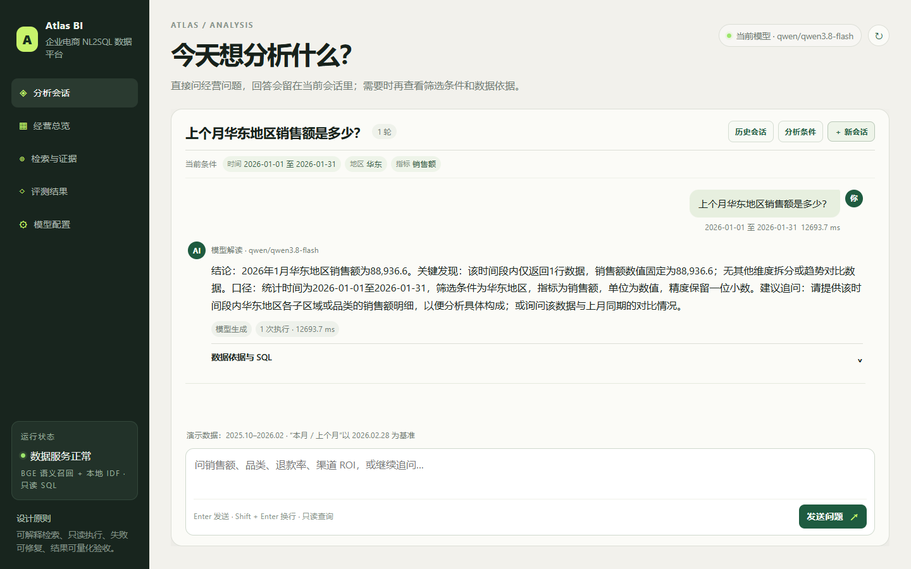
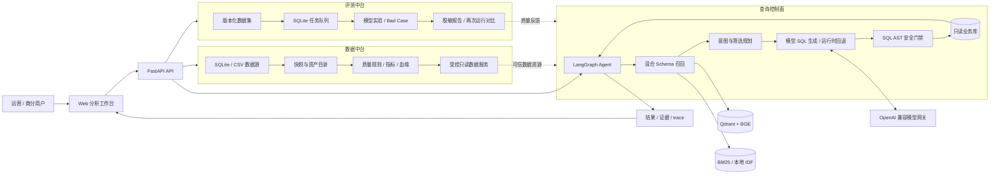
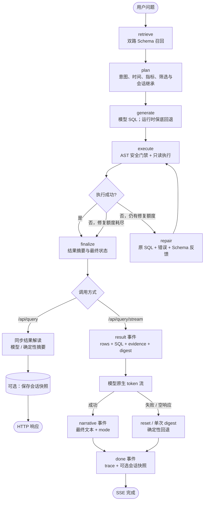
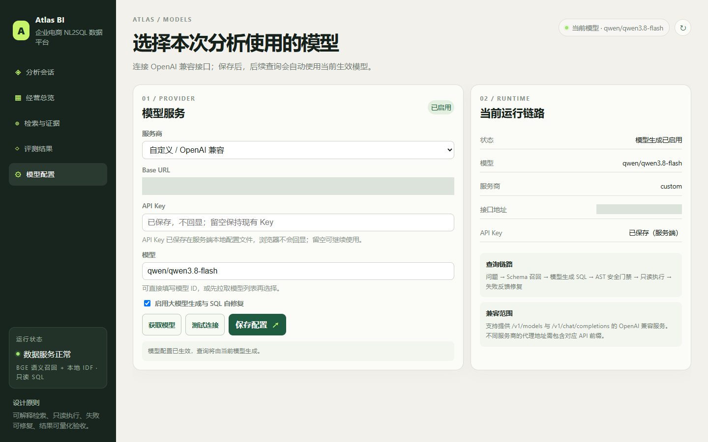
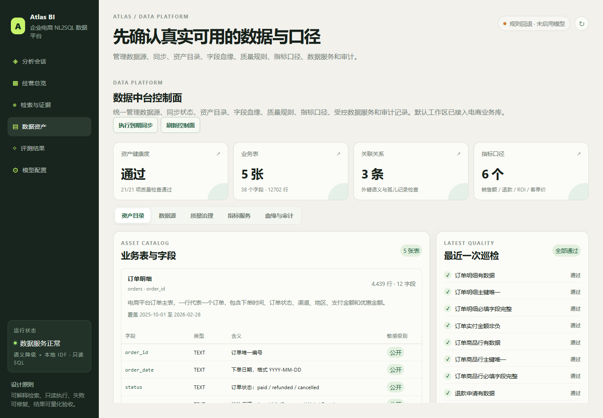
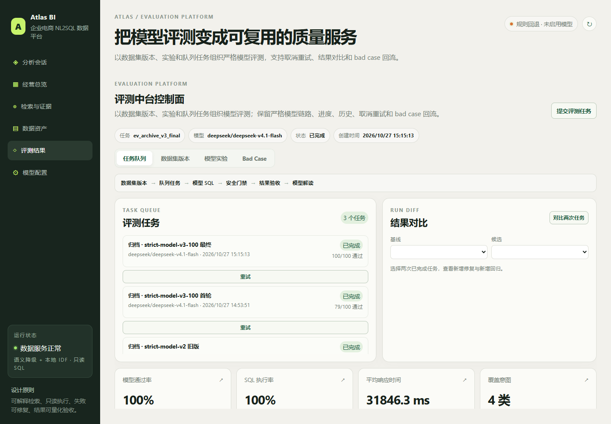

# Atlas BI · 企业级电商 NL2SQL 数据分析平台

**把自然语言经营问题转化为可执行、可审计、可复现的只读 SQL 查询。**

Atlas BI 面向电商运营、商业分析与数据团队，覆盖订单、商品、退款、投放和客户画像。平台把 Schema 召回、意图规划、模型 SQL 生成、AST 安全校验、只读执行、有界自愈和结果解读串成一条可追踪链路，并以检索证据、SQL、尝试记录和 `trace_id` 还原每次查询。数据中台负责数据源接入、快照、质量、血缘、指标和审计；评测中台负责数据集版本、模型实验、队列任务、结果对比和 bad case 回流。严格评测不使用规则 SQL 或确定性摘要补位。

[](https://github.com/sun-sh/atlas-bi-nl2sql/actions/workflows/ci.yml)




当前工作台界面（截图更新于 2026-10-27）：对话为主，历史会话与分析条件按需打开，SQL 和执行证据收在回答下方。

## 业务定位

| 维度 | 平台能力 |
| --- | --- |
| 使用对象 | 电商运营、商业分析、数据支持与业务管理团队 |
| 分析域 | 销售额、品类、退款率、ROI、客单价、趋势与渠道结构 |
| 查询链路 | 双路 Schema 召回 → 意图规划 → 模型 SQL 生成 → AST 门禁 → 只读执行 → 有界自愈 → 结果解读 |
| 接入方式 | Web 工作台、FastAPI 查询接口、受控数据服务、OpenAPI 与 OpenAI 兼容模型网关 |
| 数据治理 | SQLite/CSV 多源接入、快照、资产目录、质量规则、指标口径、字段血缘和审计 |
| 评测运营 | 数据集版本、模型实验、优先级队列、取消重试、任务对比和 bad case 回流 |
| 会话能力 | 最多 20 轮、7 天过期；显式条件优先，缺失条件按需继承 |

## 系统架构

平台不是单一的聊天页面，而是三个可独立观察的控制面：NL2SQL Agent 负责一次查询，数据中台负责数据从哪里来、是否可信，评测中台负责模型改动有没有变好。三者共享 FastAPI 进程和本地 SQLite 存储，属于**可运行的项目级控制面**，不是拆分成微服务的企业生产平台。



### Agent 编排

这里的 Agent 是**节点固定、工具固定、修复预算固定**的 LangGraph 工作流，而不是可自主挑选工具或无限循环的开放多 Agent。模型只参与 SQL 生成、SQL 修复和基于可信摘要的结果解读；它不能改写已执行的行、SQL 或证据，也不能自行扩大循环预算。



| 维度 | 当前实现 |
| --- | --- |
| 控制方式 | 固定节点 `retrieve → plan → generate → execute → finalize`；只有失败会进入 `execute → repair → execute` 的有界回路 |
| 可用工具 | Schema 检索、模型网关、SQL AST 门禁、只读数据库、会话存储；模型不能自行新增工具 |
| 模型职责 | 生成候选 SQL、结合错误修复 SQL、基于确定性摘要写分析结论；不改写结果行、SQL 或证据 |
| 失败信号 | 首次空 SQL 重试一次；AST 校验/执行错误进入修复；全空聚合结果按失败处理；默认最多修复 2 次 |
| 结果解读 | 空响应或截断按 `1800 → 3600` token 重试一次；生产链路失败回退确定性摘要，严格评测判失败 |
| 记忆范围 | 会话级短期上下文；最多 20 轮、7 天过期，不保存跨会话用户画像 |
| 严格评测 | `allow_rule_fallback=False`；规则 SQL 和摘要回退均不能算模型通过 |

## 核心能力

| 模块 | 工程实现 |
| --- | --- |
| Schema 召回 | BGE + Qdrant 语义检索与 Elasticsearch BM25 / 本地 IDF 双路召回，最终得分 `0.56 × semantic + 0.44 × lexical` |
| SQL 安全 | sqlglot AST、单条 SELECT、表/函数白名单、拒绝 `SELECT *`、敏感字段拦截、只读连接和结果行数限制 |
| 流式结果 | SSE 先推送可信 rows / SQL / evidence / digest，再流式生成模型结论；失败可 `reset` 为确定性摘要 |
| 数据中台 | SQLite/CSV 多源注册、快照/ingest、资产目录、质量规则、指标口径、字段血缘、受控只读服务和审计 |
| 评测中台 | 数据集版本、模型实验、优先级队列、取消/重试、1–3 个隔离进程、任务对比和 bad case 回流 |
| 会话与追踪 | 20 轮 / 7 天短期上下文；每次查询保留 plan、召回证据、SQL、attempts、warnings 和 `trace_id` |

## 模型接入

打开 `/models` 即可完成模型接入：配置 OpenAI 兼容 Base URL 与 API Key、在线拉取模型、运行连通性测试、保存并启用。配置写入被 Git 忽略的 `data/model_config.json`（可用 `ATLAS_MODEL_CONFIG_PATH` 覆盖）；读取接口只隐藏 API Key，会返回保存的 Base URL、模型名和 `api_key_configured`。

| 接口 | 用途 |
| --- | --- |
| `GET /api/model/config` | 获取模型配置；API Key 不回显，Base URL 可见 |
| `PUT /api/model/config` | 保存服务端配置；API Key 留空表示保留原值 |
| `POST /api/model/models` | 拉取可用模型 |
| `POST /api/model/test` | 验证端点、密钥与模型 |



模型配置界面（2026-10-27）：已保存的 Key 不回显，留空保留。截图用于展示交互，不包含真实密钥。

## 严格模型评测

`strict-model-v3-100` 使用固定的 100 条用例和最多 111 个查询轮次，覆盖时间窗口、地区、渠道、品类、销售额、销量、退款、ROI、趋势、组合筛选和 11 条两轮连续追问。每条用例用评测器中独立维护的只读基准 SQL 核对行数、维度集合、数值、排序和业务别名；评测固定 `allow_rule_fallback=False`，模型 SQL 或结果解读失败时不能用规则结果补位。

| 同一套件阶段 | 通过 | SQL 执行率 | 模型完成率 | 平均耗时 |
| --- | ---: | ---: | ---: | ---: |
| 首轮 | **79/100** | 100% | 88% | 32,545.6 ms |
| 修正后再评测 | **100/100** | 100% | 100% | 31,846.3 ms |

首轮 21 条失败包含 **12 条模型解读问题**和 **9 条结果口径问题**。修正 SQL 指令、业务口径、空 SQL / 全空聚合 / 解读重试与验收逻辑后，同套件完整复跑达到 100/100：修复 21 条，回归 0 条。这里的 21 条不能全部归因于运行时自愈；准确说法是**评测发现 → 修正约束和重试逻辑 → 独立验收再评测**的工程自愈闭环。

最终轮实际运行时 SQL 自愈触发 **2/2 成功**，首轮记录为 **1/1**。最终结果由 3 个隔离模型进程完成，使用 `deepseek/deepseek-v4.1-flash`；报告保留运行时、源码校验和与评测契约，属于带日期的在线能力快照，不是每次 CI 都能复现的固定分数。

该套件主要是由时间、地区、渠道、品类矩阵展开的**模板化回归集**，用于验证固定业务域内的链路稳定性，不等同于开放域真实问题的泛化评测。

2026-11-03 另做了一次当前配置的实时抽查：100 条中 **99/100 通过**，`roi-channels` 首次 SQL 为空导致该次失败；单独复跑该用例时触发一次模型重试并通过。因此 README 将 **2026-10-27 的 100/100** 标为归档快照，而不是当前稳定承诺。报告：[首轮](docs/evaluations/evaluation-v3-100-initial-2026-10-27.json)、[最终轮](docs/evaluations/evaluation-v3-100-2026-10-27.json)。旧版 18 条与 6 条快照仅保留在 [评测文档](docs/EVALUATION.md) 的历史部分。

## 数据中台

数据中台把项目内可访问的 SQLite/CSV 源接入为可治理资产，核心控制面包括：

- 数据源注册、`snapshot` / `ingest` 同步、工作区与 viewer / analyst / admin 函数级角色检查。
- 快照、资产目录、38 条字段血缘、5 个指标和 6 条质量规则；默认巡检 6/6 通过。
- 到期同步入口、只读数据服务、操作审计，以及独立的数据资产巡检页面。
- 内置业务库包含 `orders`、`order_items`、`refunds`、`marketing_spend`、`customers` 五张表，覆盖 2025-10 至 2026-02。

当前是可运行的项目级控制面：单工作区、默认本地管理员，不包含 SSO、多租户隔离、跨机房调度或生产数据集群。



数据中台控制面（2026-11-02）：数据源注册与同步、资产目录、质量规则、指标口径、字段血缘和审计记录。

## 评测中台

评测中台把一次模型运行保存为可追踪任务，而不是一次阻塞请求：

- 数据集版本、实验假设、bad case 反馈和归档任务统一存入 SQLite。
- 队列按优先级原子领取，单执行槽保证同时只运行一条评测；任务内部可启动 1–3 个隔离模型进程。
- 支持运行进度、取消、重试、脱敏报告、逐用例结果和两次运行 compare。
- 提交任务由 FastAPI `BackgroundTasks` 执行；也可以显式调用 claim worker。当前没有 Celery 类常驻分布式 worker，进程重启后排队记录仍在，但需要再次 claim 才能继续。



评测中台（2026-11-02）：任务队列、数据集版本、模型实验、bad case 回流和双运行差异。

## Harness 运行边界

查询工作流由 LangGraph 编排，但安全与预算不依赖 LangGraph。`app/nl2sql/harness.py` 负责生成 `RunContext` 和执行 SQL 策略：

- 只允许单条 `SELECT`；递归 CTE、`CROSS JOIN`、超过 3 个 JOIN 和投影级 `SELECT *` 直接拒绝，CTE 内的 `*` 同样检查。
- SQLite 执行受 `QUERY_TIMEOUT_SECONDS`（默认 5 秒）限制，并只读取 `MAX_RESULT_ROWS + 1` 行判断截断，不再先全量读入内存。
- 每次查询返回 `run_context`，包含 `trace_id`、策略版本、修复预算、结果行数预算和超时配置。
- 这些约束位于编排层之外，未来替换 LangGraph 也不会绕过 SQL 门禁和资源边界。

## 自愈机制

模型输出是不可信输入。运行时的自愈不是无限重试，也不是规则替模型过评测：

1. **生成阶段**：首次空 SQL 触发一次模型重试；Qwen 系列在 SQL 生成和结果解读时都关闭 thinking。
2. **执行阶段**：SQL 校验错误、未知字段、语法/执行错误和全空聚合进入 `repair`，默认最多 2 次修复。
3. **解读阶段**：空响应或截断按 `1800 → 3600` token 再试一次；生产链路仍失败则回退确定性摘要，严格评测判失败。
4. **安全边界**：原始 SQL、修复 SQL 和规则 SQL 都经过同一道 AST 门禁；模型不能修改已执行的行、证据或 SQL。

可修复的是有明确错误信号的 SQL；对于能执行但口径算错的问题，依赖业务约束、独立验收器或人工发现，不能宣称运行时自动纠正所有语义错误。

## 流式分析

`POST /api/query/stream` 使用 Server-Sent Events。标准事件顺序为：

```text
start  status*  result  [thinking]  (delta* | reset?)  narrative  done
```

- `start`：开始本轮回复。
- `status`：推送召回、规划、SQL 生成、执行、修复和整理状态。
- `result`：SQL 已执行完成，先返回可信 rows、SQL、evidence 和首屏确定性摘要。
- `thinking` / `delta`：模型组织答案及原生增量文本。
- `reset`：流中途失败时，用确定性摘要替换不完整草稿。
- `narrative`：最终结论文本和 `model` / `digest` 来源。
- `done`：本轮完成；有 `session_id` 时返回已持久化会话快照。

```bash
curl -N -X POST http://127.0.0.1:8000/api/query/stream \
  -H 'Content-Type: application/json' \
    -H 'Accept: text/event-stream' \
      -d '{"question":"上个月各渠道ROI","session_id":null}'
      ```

浏览器端使用 `fetch` + `ReadableStream` 读取 POST 响应。结果先进入同一条 AI 回复，SQL、明细和证据按需展开；模型文本再以 `delta` 增量追加。用户上翻时暂停自动跟随，可点击回到最新回答。

## API 概览

| 接口 | 说明 |
| --- | --- |
| `GET /api/health` | 数据库、检索后端、模型状态与修复配置 |
| `GET /api/overview` | 经营总览指标 |
| `POST /api/query` | 同步执行完整 NL2SQL 查询 |
| `POST /api/query/stream` | SSE 流式查询与结果解读 |
| `GET/POST /api/sessions` | 列出或创建会话 |
| `GET/DELETE /api/sessions/{id}` | 恢复或删除会话 |
| `GET /api/data-assets` | 固定业务域的数据资产巡检 |
| `GET /api/data-platform` | 数据中台概览、质量、血缘和审计 |
| `GET/POST /api/data-platform/sources` | 数据源列表与注册 |
| `POST /api/data-platform/sources/{id}/sync` | 执行快照 / ingest 同步 |
| `GET/POST /api/data-platform/metrics` | 指标目录 |
| `GET/POST /api/data-platform/quality-rules` | 质量规则 |
| `POST /api/data-platform/sources/{id}/quality` | 执行质量巡检 |
| `GET /api/data-platform/data-service` | 受控只读数据服务 |
| `POST /api/data-platform/scheduler/run` | 显式执行到期同步 |
| `GET/POST /api/evaluation/datasets` | 评测数据集版本 |
| `GET/POST /api/evaluation/experiments` | 评测实验 |
| `GET/POST /api/evaluation/feedback` | bad case 回流 |
| `GET/POST /api/evaluation/tasks` | 查看 / 提交队列任务 |
| `GET /api/evaluation/tasks/{id}` | 任务进度与报告 |
| `POST /api/evaluation/tasks/{id}/cancel` | 取消任务 |
| `POST /api/evaluation/tasks/{id}/retry` | 重试已结束任务 |
| `POST /api/evaluation/queue/claim` | 显式领取一个排队任务 |
| `GET /api/evaluation/compare` | 对比两次运行 |
| `GET /api/evaluation` | **同步兼容入口**：直接运行一次严格评测 |
| `GET /docs` | OpenAPI 交互文档 |

同步查询响应包含 `mode`、`plan`、`retrieval`、`sql`、`rows`、`attempts`、`elapsed_ms`、`warnings`、`trace_id`、`narrative` 和 `answer`；`narrative.mode` 标识 `model` / `digest`。会话查询额外返回 `session_id` 和更新后的快照，`plan.inherited` 明确列出继承条件。评测任务的正常入口是 `POST /api/evaluation/tasks`；`GET /api/evaluation` 会阻塞到同步评测结束，不适合作为页面或生产任务入口。

## 工程验证

```bash
python -m pip install -r requirements-dev.txt
python -m pytest -q
python -m app.evaluation.run
node --check app/static/app.js
```

`pytest` 固定关闭在线模型和 BGE 下载，使用真实本地数据与受控模型响应验证 API、SQL 门禁、自愈边界、会话、数据中台和评测任务。当前报告为 **97 passed**；CI 在 Python 3.12 上运行测试，并在 `LLM_ENABLED=false` 下执行模型评测冒烟检查，不产生在线模型成绩。真实 `strict-model-v3-100` 结果需要模型密钥和在线 API，是带日期的能力快照，不作为每次 CI 的确定性分数。

## 快速启动

要求 Python 3.10+；CI 在 Python 3.12 验证，当前开发环境为 Python 3.13。

```bash
python -m pip install -r requirements.txt
python -m app.nl2sql.seed
python -m uvicorn app.api.main:app --reload --port 8000
```

Windows 可运行 `run.ps1`，macOS / Linux 可运行 `./run.sh`。

| 页面 | 地址 |
| --- | --- |
| 分析会话 | http://127.0.0.1:8000/workspace |
| 经营总览 | http://127.0.0.1:8000/overview |
| 检索与证据 | http://127.0.0.1:8000/evidence |
| 数据中台 | http://127.0.0.1:8000/data-assets |
| 评测中台 | http://127.0.0.1:8000/evaluation |
| 模型配置 | http://127.0.0.1:8000/models |
| OpenAPI 文档 | http://127.0.0.1:8000/docs |

默认 `USE_BGE=true`，首次初始化检索器时会下载本地 BGE 模型；Qdrant 使用内存模式并重建 5 张表的向量索引。设置 `QDRANT_URL` 可连接远端 Qdrant，设置 `ELASTICSEARCH_URL` 可启用 BM25。

## 配置

复制 `.env.example` 为 `.env`：

| 变量 | 默认值 | 说明 |
| --- | --- | --- |
| `LLM_ENABLED` | `false` | 启用模型 SQL 生成与结果解读 |
| `LLM_PROVIDER` | `openai` | 服务商标识，也可在 `/models` 中配置 |
| `LLM_BASE_URL` | `https://api.openai.com/v1` | OpenAI 兼容接口 |
| `OPENAI_API_KEY` | 空 | 模型密钥 |
| `LLM_MODEL` | `gpt-4.1-mini` | 默认模型 |
| `USE_BGE` | `true` | 启用本地语义检索 |
| `EMBEDDING_MODEL` | `BAAI/bge-small-zh-v1.5` | 本地向量模型 |
| `QDRANT_URL` | 空 | 远端 Qdrant；空值使用内存模式 |
| `ELASTICSEARCH_URL` | 空 | Elasticsearch；空值使用本地 IDF |
| `MAX_REPAIR_ATTEMPTS` | `2` | SQL 修复上限 |
| `MAX_RESULT_ROWS` | `200` | 结果返回上限 |
| `QUERY_TIMEOUT_SECONDS` | `5` | SQLite 查询执行时间上限 |
| `ATLAS_SESSION_DB_PATH` | `data/sessions.db` | 短期会话存储路径 |
| `ATLAS_EVALUATION_DB_PATH` | `data/evaluation_tasks.db` | 评测任务、数据集、实验和反馈存储路径 |
| `ATLAS_DATA_PLATFORM_DB_PATH` | `data/data_platform.db` | 数据中台控制面元数据与审计存储路径 |
| `ATLAS_PLATFORM_WAREHOUSE_DB_PATH` | `data/platform_warehouse.db` | 数据中台快照/ingest 的本地仓储路径 |
| `ATLAS_MODEL_CONFIG_PATH` | `data/model_config.json` | 服务端模型配置；不会返回 API Key |
| `ATLAS_DISABLE_MODEL` | `0` | 设为 `1` 时强制禁用模型，便于离线验证 |

## 项目目录

```text
app/
  api/              # FastAPI 接口、数据中台与评测任务 API
  evaluation/       # 严格模型评测命令入口
  nl2sql/           # Agent、数据中台、评测任务、检索与 SQL 执行
  static/           # 工作台前端资源
data/               # 本地数据库、会话与模型配置（不入库）
docs/
  images/           # 工作台、数据中台和评测中台截图
  evaluations/      # 脱敏评测报告，包含首轮与最终结果
  EVALUATION.md     # 回归集、严格口径、数据集、实验与任务说明
  *.md              # 架构、运行、评测与体验说明
tests/              # 自动化测试
```

## 能力边界

数据侧是**可运行的项目级数据中台**：支持 SQLite/CSV 多源接入、快照同步、资产目录、字段血缘、质量规则、指标目录、受控数据服务、调度入口和审计；默认是单工作区本地部署，已提供工作区与角色检查，但不等同于已接入企业级 SSO、多租户认证或生产数据集群。评测侧是**可运行的项目级评测中台**：支持数据集版本、实验、队列任务、取消重试、结果对比和 bad case 回流，不等同于跨组织标注平台或线上流量评测平台。

## 工程文档

- [架构设计](docs/ARCHITECTURE.md)：组件边界、Agent 状态机、失败模型与扩展点。
- [运行手册](docs/OPERATIONS.md)：启动、健康检查、模型接入、平台存储与故障定位。
- [评测说明](docs/EVALUATION.md)：回归集、严格判分、数据集版本、实验、任务队列、bad case 回流与 CI 策略。
- [安全策略](SECURITY.md)：SQL 门禁、密钥管理与报告流程。
- [贡献指南](CONTRIBUTING.md)：开发流程、测试要求与提交检查。
- [用户体验检查](docs/UX_REVIEW.md)：聊天、输入、滚动与响应式布局的检查结果及剩余改进项。

## License

MIT。见 [LICENSE](LICENSE)。
