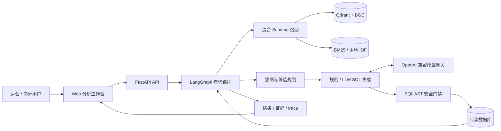
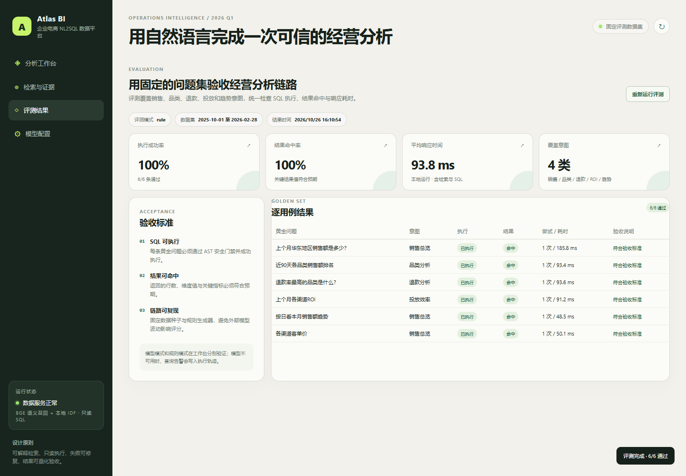

# Atlas BI · 企业级电商 NL2SQL 数据分析平台

**把自然语言经营问题转化为可执行、可审计、可复现的只读 SQL 查询。**

Atlas BI 面向电商运营、商业分析与数据团队，覆盖订单、商品、退款、投放和客户画像。平台将 Schema 召回、意图规划、SQL 生成、安全校验、只读执行、失败修复和结果解释纳入统一编排，并以检索证据、SQL 和 trace 将每次查询完整串联。

[](https://github.com/sun-sh/atlas-bi-nl2sql/actions/workflows/ci.yml)


## 业务定位

| 维度 | 平台能力 |
| --- | --- |
| 使用对象 | 电商运营、商业分析、数据支持与业务管理团队 |
| 分析域 | 销售额、品类、退款率、ROI、客单价、趋势与渠道结构 |
| 数据层 | 订单、商品行、退款、渠道投放和客户画像五张业务表 |
| 查询链路 | 双路 Schema 召回 → 意图规划 → SQL 生成 → AST 门禁 → 只读执行 → 有界修复 → 结果解释 |
| 接入方式 | Web 工作台、FastAPI 查询接口、OpenAPI 文档与 OpenAI 兼容模型网关 |

## 系统架构



## 核心能力

| 模块 | 工程实现 | 价值 |
| --- | --- | --- |
| 混合召回 | BGE 语义向量与关键词召回融合；Qdrant 默认内存模式，Elasticsearch BM25 可选 | 兼顾自然语言近义表达与业务字段精确匹配 |
| 查询规划 | 识别销售、品类、退款、投放和趋势意图，解析时间、地区、渠道、品类条件 | 将开放问题收敛为可验证的查询计划 |
| SQL 生成 | 离线规则生成器与 OpenAI 兼容模型生成共用同一执行链路 | 无模型可运行，接入模型后覆盖更自然的问法 |
| 安全执行 | sqlglot AST 校验、单条 SELECT、表/函数白名单、敏感字段拦截、只读连接、行数限制 | 在数据库执行前落实数据访问边界 |
| 有界修复 | LangGraph 捕获执行错误，结合原 SQL 与 Schema 反馈给模型，默认最多 2 次 | 失败可追踪，修复成本可控 |
| 模型网关 | 在线拉取模型、测试连接、保存服务端配置、密钥脱敏 | 模型接入与业务编排解耦 |
| 可观测性 | 召回分数、执行 SQL、尝试记录、耗时、告警和 trace ID | 从问题到结果全过程可追问 |
| 质量门禁 | 确定性数据、6 条黄金用例、26 项自动化测试、CI | 每次变更均可回归验证 |

## 安全与治理

模型输出被视为不可信输入。规则、模型与修复生成的 SQL 都必须经过同一套门禁：只允许单条 `SELECT`；校验授权表和函数；拒绝 `SELECT *`；拦截敏感字段；使用只读数据库连接；限制结果集与修复次数。模型密钥只保存在服务端，读取接口不返回明文；模型调用或修复失败会进入响应告警和查询轨迹。

详见 [SECURITY.md](SECURITY.md)。

## 模型接入

打开 `/models` 即可完成模型接入：配置 OpenAI 兼容 Base URL 与 API Key、在线拉取模型、运行连通性测试、保存并启用。配置写入被 Git 忽略的 `data/model_config.json`，读取接口仅返回脱敏状态。

| 接口 | 用途 |
| --- | --- |
| `GET /api/model/config` | 获取脱敏配置 |
| `PUT /api/model/config` | 保存服务端配置 |
| `POST /api/model/models` | 拉取可用模型 |
| `POST /api/model/test` | 验证端点、密钥与模型 |


## 可观测性与 API

| 接口 | 说明 |
| --- | --- |
| `GET /api/health` | 数据库、检索后端、模型激活状态与修复配置 |
| `GET /api/overview` | 经营总览指标 |
| `POST /api/query` | 执行完整 NL2SQL 查询链路 |
| `GET /api/evaluation` | 运行黄金评测集 |
| `GET /docs` | OpenAPI 交互文档 |

查询响应包含 `mode`、`plan`、`retrieval`、`sql`、`attempts`、`elapsed_ms`、`warnings` 和 `trace_id`，可在工作台中查看对应的召回证据与修复轨迹。

## 数据域

内置确定性数据集覆盖 2025-10 至 2026-02，包含 `orders`、`order_items`、`refunds`、`marketing_spend` 和 `customers` 五张业务表，支持销售、品类、退款、投放效率、客单价和趋势分析。

## 质量门禁

```bash
python -m pip install -r requirements-dev.txt
python -m pytest -q
python -m app.evaluation.run
```

当前快照：**26 passed**、**6/6 黄金用例命中**、SQL 执行率 **100%**、结果命中率 **100%**。评测固定使用规则生成器，避免外部模型服务影响可复现性；CI 在每个 `main` 提交上执行测试与评测。



详见 [docs/EVALUATION.md](docs/EVALUATION.md)。

## 快速启动

要求 Python 3.10+，已在 Python 3.12 和 3.13 验证。

```bash
python -m pip install -r requirements.txt
python -m app.nl2sql.seed
python -m uvicorn app.api.main:app --reload --port 8000
```

Windows 可运行 `run.ps1`，macOS / Linux 可运行 `./run.sh`。

| 页面 | 地址 |
| --- | --- |
| 分析工作台 | http://127.0.0.1:8000/workspace |
| 检索与证据 | http://127.0.0.1:8000/evidence |
| 评测中心 | http://127.0.0.1:8000/evaluation |
| 模型配置 | http://127.0.0.1:8000/models |
| OpenAPI 文档 | http://127.0.0.1:8000/docs |

首次启动会下载本地 BGE 模型；Qdrant 默认内存模式，应用启动时重建 5 张表的向量索引。设置 `QDRANT_URL` 可连接远端 Qdrant，设置 `ELASTICSEARCH_URL` 可启用 BM25。

## 配置

复制 `.env.example` 为 `.env`：

| 变量 | 默认值 | 说明 |
| --- | --- | --- |
| `LLM_ENABLED` | `false` | 启用模型 SQL 生成 |
| `LLM_BASE_URL` | `https://api.openai.com/v1` | OpenAI 兼容接口 |
| `OPENAI_API_KEY` | 空 | 模型密钥 |
| `LLM_MODEL` | `gpt-4.1-mini` | 默认模型 |
| `USE_BGE` | `true` | 启用本地语义检索 |
| `QDRANT_URL` | 空 | 远端 Qdrant；空值使用内存模式 |
| `ELASTICSEARCH_URL` | 空 | Elasticsearch；空值使用本地 IDF |
| `MAX_REPAIR_ATTEMPTS` | `2` | SQL 修复上限 |
| `MAX_RESULT_ROWS` | `200` | 结果返回上限 |

## 工程文档

- [架构设计](docs/ARCHITECTURE.md)：组件边界、查询时序、失败模型与扩展点。
- [运行手册](docs/OPERATIONS.md)：启动、健康检查、模型接入、故障定位与部署检查。
- [评测说明](docs/EVALUATION.md)：数据、指标、复现方式与 CI 策略。
- [安全策略](SECURITY.md)：SQL 门禁、密钥管理与报告流程。
- [贡献指南](CONTRIBUTING.md)：开发流程、测试要求与提交检查。

## License

MIT。见 [LICENSE](LICENSE)。
