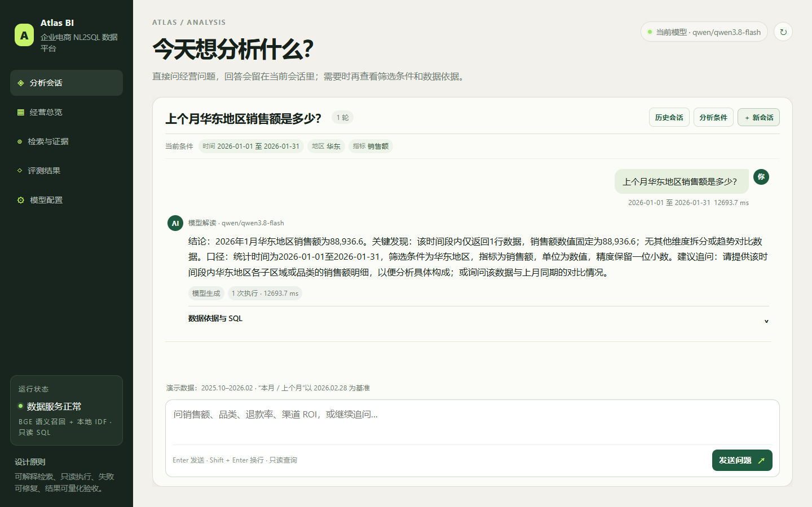
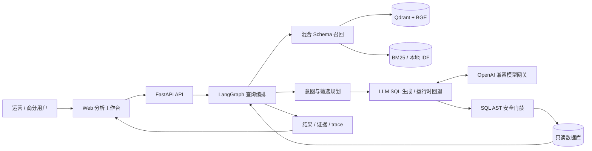
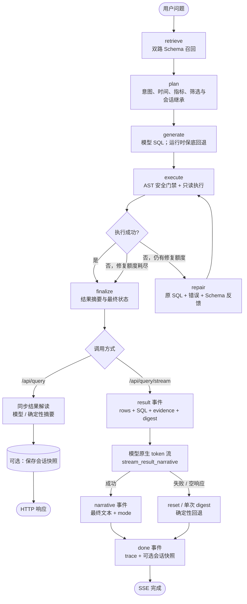
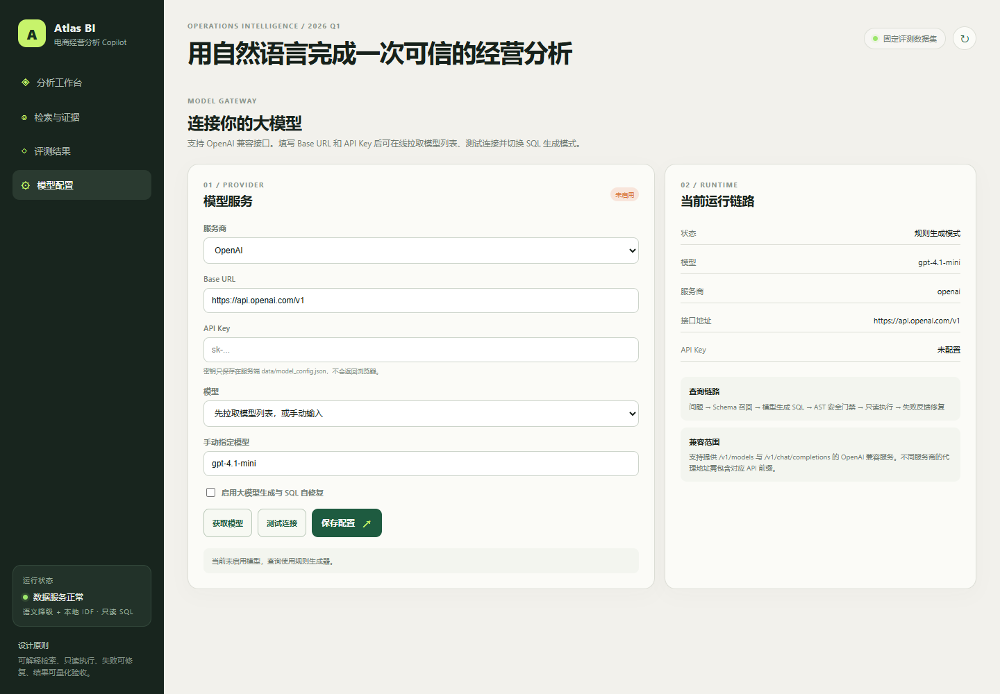
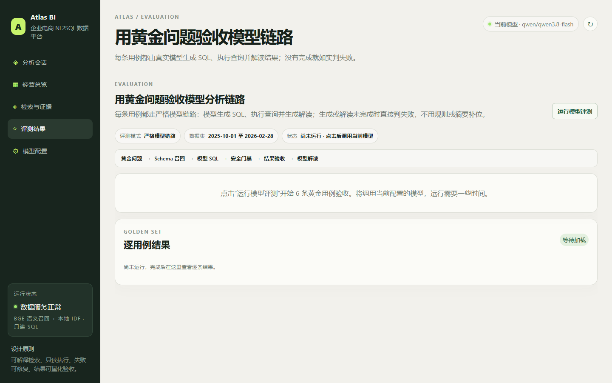

# Atlas BI · 企业级电商 NL2SQL 数据分析平台

**把自然语言经营问题转化为可执行、可审计、可复现的只读 SQL 查询。**

Atlas BI 面向电商运营、商业分析与数据团队，覆盖订单、商品、退款、投放和客户画像。平台将 Schema 召回、意图规划、SQL 生成、安全校验、只读执行、失败修复和结果解释纳入统一编排，并以检索证据、SQL 和 trace 将每次查询完整串联。模型负责理解问题、生成 SQL、基于错误自修复并解读确定性结果；SQL 结果、SQL 与证据不做模型二次改写。评测中心采用严格模型链路，模型未完成时直接判失败，不用规则补位。分析工作台支持会话级短期记忆，追问可以继承时间、指标与筛选条件。

[](https://github.com/sun-sh/atlas-bi-nl2sql/actions/workflows/ci.yml)




当前工作台界面（2026-10-27）：对话为主，历史会话与分析条件按需打开，SQL 和执行证据收在回答下方。截图展示已完成的会话，模型正确率以严格评测为准。

## 业务定位

| 维度 | 平台能力 |
| --- | --- |
| 使用对象 | 电商运营、商业分析、数据支持与业务管理团队 |
| 分析域 | 销售额、品类、退款率、ROI、客单价、趋势与渠道结构 |
| 数据层 | 订单、商品行、退款、渠道投放和客户画像五张业务表 |
| 查询链路 | 双路 Schema 召回 → 意图规划 → SQL 生成 → AST 门禁 → 只读执行 → 有界修复 → 结果解释 |
| 接入方式 | Web 工作台、FastAPI 查询接口、OpenAPI 文档与 OpenAI 兼容模型网关 |
| 会话能力 | 会话级短期记忆：最多 20 轮、7 天过期；显式条件优先，缺失条件按需继承 |

## 系统架构

### 系统全景



### Agent 编排架构

这里所说的 Agent 是一个**节点固定、工具固定、修复次数有上限**的 LangGraph 工作流，而不是可自主挑选工具或无限循环的开放 Agent。模型只参与 SQL 生成、SQL 修复和结果解读，所有 SQL 仍必须经过同一道 AST 安全门禁。



编排边界：

| 维度 | 当前实现 |
| --- | --- |
| 控制方式 | LangGraph 固定 DAG；只有执行失败会进入 `execute → repair → execute` 的有界回路 |
| 可用工具 | Schema 检索、模型网关、SQL AST 门禁、只读数据库、会话存储；模型不能自行新增工具 |
| 模型职责 | 生成候选 SQL、结合错误修复 SQL、基于确定性摘要写分析结论；不改写结果行、SQL 或证据 |
| 记忆范围 | 会话级短期上下文；最多 20 轮、7 天过期，不保存跨会话用户画像 |
| 停止条件 | SQL 成功，或校验/执行失败且修复额度耗尽；返回结果另受 `MAX_RESULT_ROWS` 截断边界约束 |
| 可观测性 | `GraphState` 保存计划、Schema 命中、SQL、尝试记录、告警和 `trace_id` |

## 核心能力

| 模块 | 工程实现 | 价值 |
| --- | --- | --- |
| 混合召回 | BGE 语义向量与关键词召回融合；Qdrant 默认内存模式，Elasticsearch BM25 可选 | 兼顾自然语言近义表达与业务字段精确匹配 |
| 查询规划 | 识别销售、品类、退款、投放和趋势意图，解析时间、地区、渠道、品类条件 | 将开放问题收敛为可验证的查询计划 |
| SQL 生成 | 模型生成 SQL；运行时保留确定性规则作为可用性保底，严格评测禁止回退补位 | 同时兼顾真实模型能力与降级可用性 |
| 安全执行 | sqlglot AST 校验、单条 SELECT、表/函数白名单、敏感字段拦截、只读连接、行数限制 | 在数据库执行前落实数据访问边界 |
| 有界修复 | LangGraph 捕获执行错误，结合原 SQL 与 Schema 反馈给模型，默认最多 2 次 | 失败可追踪，修复成本可控 |
| 模型网关 | 在线拉取模型、测试连接、保存服务端配置、密钥脱敏 | 模型接入与业务编排解耦 |
| 结果解读 | 先返回 SQL 结果，再以 SSE 流式输出模型分析结论；运行时可回退确定性摘要，严格评测要求模型解读也成功 | 首屏快、运行稳，同时不把摘要回退算成模型能力 |
| 可观测性 | 召回分数、执行 SQL、尝试记录、耗时、告警和 trace ID | 从问题到结果全过程可追问 |
| 会话记忆 | 保存近期问题、结构化查询上下文和结果；追问显示实际继承项 | 支持连续分析，同时明确条件来源 |
| 质量门禁 | 确定性数据、100 条 strict-model-v3-100 严格模型黄金用例、自动化测试与 CI | 每次变更均可回归验证 |

## 安全与治理

模型输出被视为不可信输入。规则、模型与修复生成的 SQL 都必须经过同一套门禁：只允许单条 `SELECT`；校验授权表和函数；拒绝 `SELECT *`；拦截敏感字段；使用只读数据库连接；限制结果集与修复次数。模型密钥只保存在服务端，读取接口不返回明文；模型调用或修复失败会进入响应告警和查询轨迹。

详见 [SECURITY.md](SECURITY.md)。

## 模型接入

打开 `/models` 即可完成模型接入：配置 OpenAI 兼容 Base URL 与 API Key、在线拉取模型、运行连通性测试、保存并启用。配置写入被 Git 忽略的 `data/model_config.json`，读取接口仅返回脱敏状态。

| 接口 | 用途 |
| --- | --- |
| `GET /api/model/config` | 获取脱敏配置 |
| `PUT /api/model/config` | 保存服务端配置 |
| `POST /api/model/models` | 拉取可用模型 |
| `POST /api/model/test` | 验证端点、密钥与模型 |



当前模型配置界面（2026-10-27）：已保存的 Key 不回显，留空保留；截图中的自定义服务地址已遮盖。

## 可观测性与 API

| 接口 | 说明 |
| --- | --- |
| `GET /api/health` | 数据库、检索后端、模型激活状态与修复配置 |
| `GET /api/overview` | 经营总览指标 |
| `POST /api/query` | 同步执行完整 NL2SQL 查询链路，返回结构化结果与最终分析结论 |
| `POST /api/query/stream` | 先推送查询阶段状态，再返回 SQL 结果和模型分析文本流 |
| `GET/POST /api/sessions` | 列出或创建分析会话 |
| `GET/DELETE /api/sessions/{id}` | 恢复或删除会话 |
| `GET /api/evaluation` | 运行黄金评测集 |
| `GET /docs` | OpenAPI 交互文档 |

同步响应包含 `mode`、`plan`、`retrieval`、`sql`、`rows`、`attempts`、`elapsed_ms`、`warnings`、`trace_id`、`narrative` 和 `answer`；`answer` 是最终结论文本，`narrative.mode` 标识 `model` / `digest`。流式接口的 `result` 事件先携带完整结构化结果与首屏确定性摘要，最终结论在后续 `narrative` 事件的 `text` 字段中返回。会话查询还返回 `session_id` 与更新后的会话快照；`plan.inherited` 明确列出本轮继承的时间、指标或筛选条件。

### 流式分析

`POST /api/query/stream` 使用 Server-Sent Events (SSE)。标准事件顺序为：

```text
start → status* → result → [thinking] → (delta* | reset?) → narrative → done
```

- `start`：已接收问题，在聊天区创建本轮回复。
- `status`：召回、规划、SQL 生成、执行、修复和整理结果的阶段状态；在对应节点开始时发送。
- `result`：SQL 已执行完成，包含完整结果、SQL、证据和首屏确定性摘要；在同一条 AI 回复中展示，明细和 SQL 按需展开。
- `thinking`：可选，模型正在组织答案。
- `delta`：追加模型原生流式内容；模型未启用时，确定性摘要作为单个 `delta` 推送。
- `reset`：模型流中途失败时，用确定性摘要替换已收到的草稿。
- `narrative`：最终结论文本及来源模式（`model` / `digest`），客户端应以该事件为准。
- `done`：本轮完成；存在 `session_id` 时返回已持久化的会话快照。

```bash
curl -N -X POST http://127.0.0.1:8000/api/query/stream \
  -H 'Content-Type: application/json' \
  -H 'Accept: text/event-stream' \
  -d '{"question":"上个月各渠道ROI","session_id":null}'
```

浏览器端使用 `fetch` + `ReadableStream` 读取 POST 响应。SQL 生成与执行期间推送阶段状态，结果解读使用模型原生文本流。用户上翻时暂停自动跟随，可点击“回到最新回答”继续查看。进入评测页面不会自动运行模型评测，需点击“运行模型评测”。

## 数据域

内置确定性数据集覆盖 2025-10 至 2026-02，包含 `orders`、`order_items`、`refunds`、`marketing_spend` 和 `customers` 五张业务表，支持销售、品类、退款、投放效率、客单价和趋势分析。

## 质量门禁

```bash
python -m pip install -r requirements-dev.txt
python -m pytest -q
python -m app.evaluation.run
```

当前严格模型评测集为 **100 条 strict-model-v3-100 用例**，由时间窗口、地区、渠道、品类、销量、退款、ROI、趋势、交叉筛选和连续追问矩阵组成；每条用例用独立只读 SQL 基准核对行数、维度、数值和排序。评测要求模型生成 SQL 并完成结果解读，禁止规则 SQL 或确定性摘要补位。

2026-10-27 使用当前配置模型完成的一次 **strict-model-v2 旧版 18 条评测**为 **5/18 通过**，命中率 **27.8%**，SQL 执行率 **55.6%**，模型完成率 **44.4%**，平均每条用例 **15.4 秒**。该结果用于定位自愈和模型问题，不能代表新增 100 条套件的成绩；完整脱敏结果见 [strict-model-v2 评测 JSON](docs/evaluation-v2-2026-10-27.json)。

2026-10-27 使用当前配置的 `deepseek/deepseek-v4.1-flash` 完成 strict-model-v3-100 在线评测：**100/100 通过，命中率 100.0%，SQL 执行率 100.0%，模型完成率 100.0%**；3 个隔离进程运行，90% 质量门槛通过。共 2 条用例触发模型自愈，均修复成功。完整脱敏结果见 [strict-model-v3-100 评测 JSON](docs/evaluation-v3-100-2026-10-27.json)。

完整在线运行最多处理 111 个查询轮次（含 11 条两轮追问链）；每个查询轮次可能包含 SQL 生成、有限修复和结果解读请求。该成本与模型服务响应时间会随配置变化。

保留的严格模型评测截图为 **2026-10-26** 的一次旧版 6 条用例历史运行：**4/6 通过**，结果命中率 **66.7%**、模型 SQL 执行率 **83.3%**、平均响应 **3431.6 ms**。参见[历史评测结果截图](docs/atlas-evaluation-latest.png)。该结果依赖当时模型与网络，不代表当前 100 条用例的成绩。



当前评测界面（2026-10-27）：进入页面不会自动运行；点击“运行模型评测”后才调用模型，完成后显示本轮真实结果。上图为未运行状态，本轮截图更新没有重新运行黄金评测。

详见 [docs/EVALUATION.md](docs/EVALUATION.md)。

## 快速启动

要求 Python 3.10+，已在 Python 3.12 和 3.13 验证。

```bash
python -m pip install -r requirements.txt
python -m app.nl2sql.seed
python -m uvicorn app.api.main:app --reload --port 8000
```

Windows 可运行 `run.ps1`，macOS / Linux 可运行 `./run.sh`。

| 页面 | 地址 |
| --- | --- |
| 分析会话 | http://127.0.0.1:8000/workspace |
| 经营总览 | http://127.0.0.1:8000/overview |
| 检索与证据 | http://127.0.0.1:8000/evidence |
| 评测中心 | http://127.0.0.1:8000/evaluation |
| 模型配置 | http://127.0.0.1:8000/models |
| OpenAPI 文档 | http://127.0.0.1:8000/docs |

默认 `USE_BGE=true`，首次初始化检索器时会下载本地 BGE 模型；Qdrant 使用内存模式并重建 5 张表的向量索引。设置 `QDRANT_URL` 可连接远端 Qdrant，设置 `ELASTICSEARCH_URL` 可启用 BM25。

## 配置

复制 `.env.example` 为 `.env`：

| 变量 | 默认值 | 说明 |
| --- | --- | --- |
| `LLM_ENABLED` | `false` | 启用模型 SQL 生成与结果解读 |
| `LLM_PROVIDER` | `openai` | 服务商标识，也可在 `/models` 中配置 |
| `LLM_BASE_URL` | `https://api.openai.com/v1` | OpenAI 兼容接口 |
| `OPENAI_API_KEY` | 空 | 模型密钥 |
| `LLM_MODEL` | `gpt-4.1-mini` | 默认模型 |
| `USE_BGE` | `true` | 启用本地语义检索 |
| `EMBEDDING_MODEL` | `BAAI/bge-small-zh-v1.5` | 本地向量模型 |
| `QDRANT_URL` | 空 | 远端 Qdrant；空值使用内存模式 |
| `ELASTICSEARCH_URL` | 空 | Elasticsearch；空值使用本地 IDF |
| `MAX_REPAIR_ATTEMPTS` | `2` | SQL 修复上限 |
| `MAX_RESULT_ROWS` | `200` | 结果返回上限 |
| `ATLAS_SESSION_DB_PATH` | `data/sessions.db` | 短期会话存储路径 |

## 工程文档

- [架构设计](docs/ARCHITECTURE.md)：组件边界、查询时序、失败模型与扩展点。
- [运行手册](docs/OPERATIONS.md)：启动、健康检查、模型接入、故障定位与部署检查。
- [评测说明](docs/EVALUATION.md)：数据、指标、复现方式与 CI 策略。
- [安全策略](SECURITY.md)：SQL 门禁、密钥管理与报告流程。
- [贡献指南](CONTRIBUTING.md)：开发流程、测试要求与提交检查。
- [用户体验检查](docs/UX_REVIEW.md)：聊天、输入、滚动与响应式布局的检查结果及剩余改进项。

## License

MIT。见 [LICENSE](LICENSE)。
