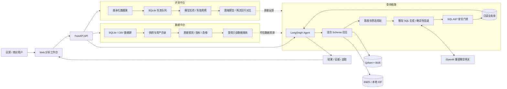

# Atlas BI｜电商 NL2SQL 智能分析平台

**用中文问经营数据，系统生成只读 SQL，并把结果解释清楚。**

Atlas BI 是一个可运行、可评测的电商经营分析作品：从自然语言问题出发，经过 Schema 召回、意图规划、SQL 生成、安全门禁、只读执行和结果解读，最终在 Web 工作台展示数据、SQL、证据和解释。它不是聊天机器人套壳，也不是已经完成生产化的数据库网关。

[](https://github.com/sun-sh/atlas-bi-nl2sql/actions/workflows/ci.yml)


[3 分钟运行](#3-分钟运行) · [架构](#系统架构) · [评测证据](#评测证据) · [API](#api) · [边界](#边界)

## 先说结论

| 判断 | 结论 |
| --- | --- |
| 是不是一个完整项目 | 是。查询、会话、数据中台、评测中台、前端、测试和 CI 都在同一个可运行仓库里。 |
| 能不能现场演示 | 能。无模型 Key 也能用确定性规则链路跑通；配置 OpenAI 兼容模型后走模型生成和模型解读。 |
| 有没有真实证据 | 有。191 项自动化测试、严格模型回归 100/100、holdout 29/30、冻结口语 7/13、规则等价 100/100、自然语言 15/15 和检索/路由消融均可复现。 |
| 够不够面试 | 够。它覆盖 Agent 编排、RAG/检索、SQL 安全、结果验收、SSE、评测工程和工程边界，适合准备 AI 应用 / 后端岗位。 |
| 是不是生产平台 | 不是。真实数据库集成、连接池、SSO、多租户、分布式 worker 和完整安全治理仍是后续工作；见 [AUDIT](docs/AUDIT.md)。 |

## 项目解决什么问题

电商经营问题通常不是“生成一条能跑的 SQL”这么简单：

- 问题里有中文业务别名、相对时间、渠道、品类、地区和指标口径，模型容易召回错表或算错口径。
- SQL 能执行也不代表业务正确，仍可能字段错、时间错、聚合粒度错或排序错。
- 结果解读可能引用不存在的数据，甚至把非榜首写成最高。
- 模型失败时需要有限修复，不能无限重试，也不能用规则结果冒充模型通过。

Atlas BI 把这条链路拆成可追踪的节点，并为每一层保留证据和失败原因。项目定位是**受控的分析 Agent**：模型负责理解、生成和修复，规则负责边界、校验和验收。

## 系统架构

查询 Agent 负责回答，数据中台管理数据来源和质量，评测中台记录模型改动。三部分共用一个 FastAPI 进程和本地 SQLite，没有拆成微服务。



### Agent 怎么工作

这里的 Agent 没有让模型自由选工具。节点、工具和修复次数都是固定的：模型负责生成 SQL、根据错误修 SQL、基于已经执行的结果写结论；它不能改写已执行的行、SQL 或证据，也不能自己增加循环次数。


| 维度 | 实现 |
| --- | --- |
| 控制方式 | 固定节点 `retrieve → plan → generate → execute → finalize`；只有失败才进入 `execute → repair → execute`，次数有上限 |
| 可用工具 | Schema 检索、模型接口、SQL AST 门禁、只读数据库和会话存储；模型不能自己加工具 |
| 模型负责什么 | 生成 SQL、结合错误修 SQL、基于确定性摘要写结论；不能改已经执行的行、SQL 或证据 |
| 什么时候修 | 首次空 SQL 重试一次；AST 校验或执行错误进入修复；全空聚合也算失败；默认最多修 2 次 |
| 结果解读 | 空响应或截断时按 `1800 → 3600` token 重试一次；运行时失败会回退确定性摘要，严格评测则判失败 |
| 记忆范围 | 只保存当前会话的短期上下文；最多 20 轮、7 天过期，不做跨会话用户画像 |
| 评测口径 | `allow_rule_fallback=False`；规则 SQL 和摘要回退都不算模型通过 |

## 主要能力

| 模块 | 实现 |
| --- | --- |
| 可答性判定 | 模糊问题先要求补充指标；因果问题只提供可查询的拆解方向；写操作、敏感字段和域外请求在生成 SQL 前拒绝；澄清和拒答不生成伪造查询计划 |
| Schema 检索 | BGE + Qdrant 与 Elasticsearch BM25 / 本地 IDF 双路召回，作为 Schema 证据和可选补充；5 表业务域默认只用确定性必需表，`ATLAS_RETRIEVAL_SUPPLEMENTS=1` 才允许最多一张 top-1 补充表进入 Prompt |
| SQL 安全 | sqlglot AST、单条 SELECT、表/函数白名单、跨 Schema 拦截、拒绝 `SELECT *`、敏感字段拦截、只读连接和结果行数限制 |
| 有限自愈 | 记录原 SQL、错误、Schema 和尝试次数，在预算内让模型修复；修复 SQL 仍走同一门禁；预算耗尽保留失败状态，业务语义错误仍可能通过执行 |
| 结果解读 | 先执行可信查询，再生成解释；数字、榜首和趋势必须与确定性摘要一致，失败时回退摘要 |
| 流式体验 | SSE 先推结果、SQL、检索依据和确定性摘要，再流式生成模型结论；失败时用 `reset` 换成完整摘要 |
| 会话 | 最多 20 轮、7 天过期；新问题条件优先，缺失条件按需继承，额外条件会进入计划上下文 |
| 数据中台 | SQLite/CSV 注册、快照、资产目录、质量规则、指标口径、字段血缘、只读服务和审计；PostgreSQL/MySQL 可作为查询目标 |
| 评测中台 | 数据集版本、模型实验、优先级队列、取消与重试、1–3 个隔离进程、任务对比、失败候选审核后回流 |
| 运行观测 | `/api/metrics` 进程内请求数、错误率和 P50/P95/Max；模型调用并发、排队和 token 指标；可选运营令牌 |
| 可测试性 | 191 项 pytest；4 条 Playwright 浏览器用例；规则、自然语言、检索和范围门禁均在 CI 中运行 |

## 评测证据

这里最重要的一条是：**固定数据集上的回归结果不等于开放域生产准确率。**

100 条回归集是 19 个业务题型族在时间、地区、渠道和品类上的矩阵扩展，因此同时报告 raw case 与题型族。规则 100/100 验证的是回归门禁，不是模型能力。冻结口语集采用“先冻结题目、再改语义层”的流程，当前为 7/13，不用开发集的高分替代它。

| 证据 | 结果 | 说明 |
| --- | --- | --- |
| 严格模型回归 `strict-model-v3-100` | **100/100（19 个题型族）** | 默认确定性必需表路由、固定模型和网络条件下的日期快照；raw case 不等于独立语义样本 |
| 独立 holdout `strict-model-v3-holdout-30` | **29/30** | 不参与调参的 30 条问题；销售 17/17、品类 3/3、退款 6/6、ROI 3/4 |
| 规则链路等价 `rule-equivalence-v1` | **100/100（19 个题型族）** | 不调用模型；raw case 是时间/筛选矩阵，独立单位看题型族 |
| 自然语言变体 `natural-language-holdout-v1` | **15/15（8 个题型族）** | 确定性规则链路 + 真实执行，不是模型能力 |
| 冻结口语严格模型 `colloquial-frozen-v3` | **7/13** | 题目先单独冻结；10 条可回答、3 条应澄清；执行率/模型率 61.5%，失败集中在口语同义词、退款指标和澄清边界 |
| 检索上下文消融 | 必需表 **7/13** vs 必需表 + top-1 补充 **7/13** | 同一冻结题集和同一 source hash；逐题命中一致，未观察到生成增益，默认关闭 |
| 检索搜索消融 `retrieval-ablation-v1` | Top-1 **91.7%**、MRR **0.9444**、完整表召回@4 **100%** | 当前本地词法降级快照；仅证明 12 条小样本上的 Schema 搜索，不是 SQL 生成收益；其中已有销售问法 top-1 错排 |
| 范围守卫 `scope-guard-v1` | **7/7** | 模糊、写操作、敏感字段、域外请求必须澄清或拒答，不产生 SQL 和结果行 |
| HTTP 冒烟压测 | 20 请求、并发 4、20/20 成功、P50 55.7 ms、P95 158.6 ms | 关闭模型、规则 SQL、固定 SQLite；不是 LLM 延迟或生产容量 |

详细判分、历史快照、任务队列和复现方式见 [评测说明](docs/EVALUATION.md)。

## 3 分钟运行

需要 Python 3.10+，CI 使用 Python 3.12。

```bash
git clone https://github.com/sun-sh/atlas-bi-nl2sql.git
cd atlas-bi-nl2sql
python -m venv .venv
# Windows: .venv\Scripts\activate
# macOS / Linux: source .venv/bin/activate
python -m pip install -r requirements.txt
python -m app.nl2sql.seed
python -m uvicorn app.api.main:app --reload --port 8000
```

也可以直接运行 `run.ps1`（Windows）或 `./run.sh`（macOS / Linux）。打开 <http://127.0.0.1:8000/workspace> 即可提问。

不配置模型 Key 时，系统使用确定性规则生成器，适合离线演示和验证。配置 OpenAI 兼容接口后，SQL 生成和结果解读走模型；严格模型评测仍会关闭规则补丁，避免把规则结果算成模型成绩。

### 页面

| 页面 | 地址 |
| --- | --- |
| 分析会话 | <http://127.0.0.1:8000/workspace> |
| 经营总览 | <http://127.0.0.1:8000/overview> |
| 检索与证据 | <http://127.0.0.1:8000/evidence> |
| 数据中台 | <http://127.0.0.1:8000/data-assets> |
| 评测中台 | <http://127.0.0.1:8000/evaluation> |
| 模型配置 | <http://127.0.0.1:8000/models> |
| OpenAPI | <http://127.0.0.1:8000/docs> |

## 接入模型

1. 在 `/models` 填写 provider、Base URL、模型名和 API Key。
2. 获取模型列表并执行连接测试。
3. 保存并启用模型。
4. 返回工作台提问；响应中的 `mode` 会标明 `llm`、`llm-repair`、`rule` 或失败状态。

也可以使用环境变量：

```bash
export LLM_ENABLED=true
export LLM_PROVIDER=openai
export LLM_BASE_URL=https://api.openai.com/v1
export OPENAI_API_KEY=...
export LLM_MODEL=gpt-4.1-mini
```

模型配置保存在 `data/model_config.json`（可用 `ATLAS_MODEL_CONFIG_PATH` 覆盖），文件排除在 Git 之外。公共配置接口不会返回 API Key，但部署时仍应使用文件权限或密钥管理服务。模型调用失败时，查询响应会记录 `warnings`；正常模式可回退规则 SQL，严格评测不会回退。

## API

| 接口 | 说明 |
| --- | --- |
| `GET /api/health` | 当前分析库、检索后端、模型状态与修复配置 |
| `GET /api/metrics` | 进程内请求数、错误率和 P50/P95/Max 延迟；查询路由默认不消费检索补充 |
| `GET /api/overview` | 经营总览指标 |
| `GET /api/examples` | 获取工作台示例问题 |
| `POST /api/query` | 同步执行完整 NL2SQL 查询 |
| `POST /api/query/stream` | SSE 流式查询与结果解读 |
| `POST /api/query/cancel/{trace_id}` | 请求停止运行中的查询 |
| `GET/POST /api/sessions` | 列出或创建会话 |
| `GET/DELETE /api/sessions/{id}` | 恢复或删除会话 |
| `GET /api/data-assets` | 固定业务域的数据资产巡检 |
| `GET /api/data-platform` | 数据中台概览、质量、血缘和审计 |
| `GET/POST /api/data-platform/workspaces` | 工作区列表与创建 |
| `GET/POST /api/data-platform/sources` | 数据源列表与注册 |
| `POST /api/data-platform/sources/{id}/sync` | 执行快照或入库同步 |
| `POST /api/data-platform/sources/{id}/activate` | 将兼容 SQLite/PostgreSQL/MySQL 设为当前 NL2SQL 分析库 |
| `GET/POST /api/data-platform/metrics` | 指标目录 |
| `GET/POST /api/data-platform/quality-rules` | 质量规则 |
| `POST /api/data-platform/sources/{id}/quality` | 执行质量巡检 |
| `GET /api/data-platform/data-service` | 受控只读数据服务（当前仅支持 SQLite 快照） |
| `POST /api/data-platform/scheduler/run` | 手动执行到期同步 |
| `GET/POST /api/evaluation/datasets` | 评测数据集版本 |
| `GET/POST /api/evaluation/experiments` | 评测实验 |
| `GET/POST /api/evaluation/feedback` | 失败用例反馈 |
| `POST /api/evaluation/tasks/{id}/regression-candidates` | 从失败报告生成待审核回归候选 |
| `GET /api/evaluation/regression-candidates` | 查看待审或已批准的回归候选 |
| `POST /api/evaluation/regression-candidates/approve` | 审核候选并生成数据集版本 |
| `GET/POST /api/evaluation/tasks` | 查看或提交评测任务 |
| `GET /api/evaluation/tasks/{id}` | 任务进度与报告 |
| `POST /api/evaluation/tasks/{id}/cancel` | 取消任务 |
| `POST /api/evaluation/tasks/{id}/retry` | 重试已经结束的任务 |
| `POST /api/evaluation/queue/claim` | 手动领取一个排队任务 |
| `GET /api/evaluation/compare` | 对比两次运行；返回可比性标记 |
| `GET /api/evaluation` | 旧同步评测入口，默认返回 410；仅显式设置 `ATLAS_ENABLE_SYNC_EVALUATION=1` 时启用 |
| `GET /docs` | OpenAPI 交互文档 |

同步查询返回计划、召回结果、SQL、数据、尝试记录、告警、`trace_id` 和解读。`narrative.mode` 标明解读来自模型还是确定性摘要。带会话的查询还会返回 `session_id` 和更新后的快照，`plan.inherited` 列出继承了哪些条件。评测任务走 `POST /api/evaluation/tasks`；`GET /api/evaluation` 默认关闭，避免公网请求同步跑完整评测并消耗模型额度。

## SSE 事件

`POST /api/query/stream` 使用 Server-Sent Events：

```text
start → status* → result → [thinking] → (delta* | reset?) → narrative → done
```

- `status`：召回、规划、生成、执行、修复和整理阶段。
- `result`：SQL 已执行完成，先返回结果、SQL、检索依据和首屏摘要。
- `thinking` / `delta`：模型开始写结论及逐段文本。
- `reset`：流中途失败时，用确定性摘要替换不完整草稿。
- `narrative`：最终文本和 `model` / `digest` 来源。
- `done`：本轮完成；有会话时返回持久化快照。
- `cancelled`：用户停止分析或请求中断；浏览器保留已收到的可信结果。

```bash
curl -N -X POST http://127.0.0.1:8000/api/query/stream \
  -H 'Content-Type: application/json' \
  -H 'Accept: text/event-stream' \
  -d '{"question":"上个月各渠道ROI","session_id":null}'
```

## 验证

```bash
python -m pip install -r requirements-dev.txt
python -m pytest -q
python -m app.evaluation.run --suite scope --min-hit-rate 100
python -m app.evaluation.run --suite rules --min-hit-rate 100
python -m app.evaluation.run --suite retrieval --min-hit-rate 100
python -m app.evaluation.run --suite natural --min-hit-rate 100
# 需要已启用模型并消耗在线配额
python -m app.evaluation.run --suite colloquial-frozen --min-hit-rate 0
node --check app/static/app.js
```

`pytest` 默认关闭在线模型和 BGE 下载，使用本地数据和受控模型响应测试 API、SQL 门禁、修复、会话、数据中台和评测任务。当前 **191 项测试全部通过**，包含 4 条 Playwright 浏览器端到端用例。CI 在 Python 3.12、`LLM_ENABLED=false`、`USE_BGE=false` 下运行，不产生在线模型分数；`scope`、`rules`、`retrieval`、`natural` 四套门禁不依赖模型 Key。`colloquial-frozen` 是严格模型快照，需要模型 Key，不设固定 CI 分数；开发集 `colloquial` 仅用于调试。在线模型评测需要配置 Key 和 API，结果会随模型、网络和配置变化。

## 目录结构

```text
app/
  api/              # FastAPI 路由、运营门禁、查询与评测入口
  evaluation/       # 评测 CLI、HTTP 压测
  nl2sql/
    workflow.py     # LangGraph 查询状态机
    retrieval.py    # BGE/Qdrant + BM25/IDF 混合召回
    planner.py      # 意图、时间、指标、筛选与上下文继承
    generator.py    # 模型 SQL、规则 SQL、有限修复
    sql_engine.py   # 方言校验、只读适配器、结果行数限制
    harness.py      # 运行预算、取消与 SQL 策略
    result_insight.py # 结果摘要、模型解读与事实校验
    data_platform.py  # 数据源、快照、质量、指标、血缘与审计
    evaluation.py     # 严格模型评测与离线套件
    evaluation_tasks.py # 数据集、实验、队列、重试与失败回流
  static/           # 工作台前端资源
data/               # 本地数据库、会话与模型配置（不入库）
docs/
  images/           # 页面截图
  evaluations/      # 回归、holdout、范围、检索和压测报告
  ARCHITECTURE.md   # 组件边界、状态机、存储和扩展点
  OPERATIONS.md     # 启动、健康检查、令牌、部署和故障定位
  EVALUATION.md     # 评测口径、数据集、实验、队列和历史快照
  AUDIT.md          # 本次审计修复与仍未完成的边界
tests/              # 自动化测试和浏览器端到端测试
```

## 边界

- 当前使用固定种子的电商数据和固定业务口径，换成其他业务需要补 Schema、业务规则和评测用例。
- 可答性判定以规则为主，覆盖常见澄清、写操作、敏感字段和域外请求；它会减少硬答，但不能替代完整权限系统和人工复核。
- 数据中台是单工作区、本地管理员，只有函数级角色检查；`X-Admin-Token` 只是可选的共享部署门禁，没有 SSO、多租户隔离、用户级授权和生产数据集群。外部 PostgreSQL/MySQL 目前只作为 NL2SQL 查询目标，读数据服务仍仅支持 SQLite 快照。
- CSV 单表入库不能切换成 NL2SQL 分析库；SQLite 和显式配置的 PostgreSQL/MySQL 才能被启用为查询数据源。外部库适配器暂不含连接池、租户行级过滤和自动目录同步；DSN 以明文保存在本地元数据中，公开接口不返回，但部署时仍需文件权限和密钥管理。
- `/api/metrics` 是单进程内存窗口，进程重启即清零，也不包含网关、数据库连接池或模型供应商侧指标；HTTP 压测关闭模型，不能当作 LLM 容量结论。
- 评测中台使用 SQLite 队列和单执行槽，没有分布式后台进程、跨组织标注或线上流量评测。
- 100 条回归集并不是 100 个独立语义样本：它由 19 个业务题型族在时间、地区、渠道和品类上扩展而来。README 同时报告 raw case 与题型族，避免把矩阵规模误读成语义覆盖。
- 默认 SQL 生成只使用确定性业务必需表；检索是证据和可选补充，不是当前五表 Demo 的默认生成增益。开启一张检索补充表后，冻结口语集仍为 7/13，逐题命中一致且没有补充表进入可答题计划，因此默认值为 0。
- 严格模型回归 **100/100**、holdout **29/30**、冻结口语 **7/13** 都是当前模型、网络和固定数据条件下的日期快照，不是开放域生产准确率，也不是稳定承诺。

## 文档

- [架构设计](docs/ARCHITECTURE.md)：组件边界、Agent 状态机、分析库切换、运行指标和失败处理。
- [运行手册](docs/OPERATIONS.md)：启动、健康检查、管理令牌、分析库启用、压测、平台存储与故障定位。
- [评测说明](docs/EVALUATION.md)：严格模型评测、自然语言变体、检索消融、HTTP 压测、数据集和任务队列。
- [项目审计](docs/AUDIT.md)：本轮修复、仍未完成的生产化边界和避免夸大的说法。
- [安全策略](SECURITY.md)：SQL 门禁、密钥管理与报告流程。
- [贡献指南](CONTRIBUTING.md)：开发流程、测试要求与提交检查。

个人面试讲稿和简历草稿保存在本地，不随开源仓库发布；可复现的技术证据以架构、运行手册、评测说明和审计文档为准。

## License

MIT，见 [LICENSE](LICENSE)。
