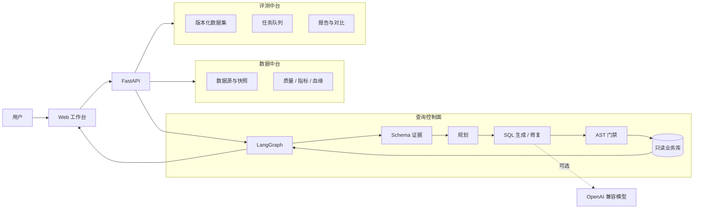

# Atlas BI｜电商 NL2SQL 智能分析平台

**用中文问经营数据，生成只读 SQL，并解释可核对的查询结果。**

Atlas BI 是一个面向固定电商业务域的自托管 NL2SQL 分析应用。它将自然语言问题转换为受约束的只读 SQL，并保留规划、检索、执行、验收和解读证据，便于本地演示、评测和二次开发。

[](https://github.com/sun-sh/atlas-bi-nl2sql/actions/workflows/ci.yml)


[快速开始](#快速开始) · [架构](#架构) · [评测](#评测) · [API](docs/API.md) · [边界](#设计边界) · [文档](#文档)

## 功能

- **受控查询链路**：意图守卫 → Schema 证据 → 规划 → SQL 生成/修复 → AST 门禁 → 只读执行 → 结果验收与解读。
- **业务语义单一事实源**：`app/semantic.yaml` 统一维护表、列、枚举、别名、时间词和指标 `expr + filters`，并渲染 SQLite DDL、Prompt、规则 SQL、概览指标与评测常量。
- **SQL 安全边界**：单条 `SELECT`、表/函数白名单、跨 Schema 拦截、敏感字段拦截、禁止 `SELECT *`、JOIN 与真实子查询深度限制、只读连接、超时、取消和行数上限。
- **可验证结果**：严格评测使用独立基准 SQL 比对行数、分组、数值与排序；模型解读必须通过数字、排名和趋势的事实一致性校验。
- **有限自愈**：记录原始 SQL、错误与尝试次数，在预算内让模型修复；修复后的 SQL 仍经过同一门禁。
- **SSE 流式输出**：先返回可信结果、SQL 和证据，再流式输出受摘要约束的模型解读。
- **数据与评测中台**：数据源快照、质量规则、指标与血缘；版本化数据集、实验、任务队列、取消/重试、运行对比和失败用例回流。
- **可选检索后端**：核心安装使用本地 IDF；BGE、Qdrant 与 Elasticsearch 通过扩展依赖按需启用。

## 快速开始

需要 Python 3.10+，CI 使用 Python 3.12。

```bash
git clone https://github.com/sun-sh/atlas-bi-nl2sql.git
cd atlas-bi-nl2sql
python -m venv .venv
# Windows: .venv\Scripts\activate
# macOS / Linux: source .venv/bin/activate
python -m pip install -r requirements.txt
python -m app.nl2sql.seed
python -m uvicorn app.api.main:app --reload --port 8000
```

也可以运行 `run.ps1`（Windows）或 `./run.sh`（macOS / Linux）。打开 <http://127.0.0.1:8000/workspace> 开始提问。

默认安装不包含 BGE、Qdrant 或 Elasticsearch，`USE_BGE=false`，检索走本地 IDF。需要使用完整检索后端时：

```bash
python -m pip install -r requirements-retrieval.txt
```

### 页面

| 页面 | 地址 |
| --- | --- |
| 分析会话 | <http://127.0.0.1:8000/workspace> |
| 经营总览 | <http://127.0.0.1:8000/overview> |
| 检索与证据 | <http://127.0.0.1:8000/evidence> |
| 数据中台 | <http://127.0.0.1:8000/data-assets> |
| 评测中台 | <http://127.0.0.1:8000/evaluation> |
| 模型配置 | <http://127.0.0.1:8000/models> |
| OpenAPI | <http://127.0.0.1:8000/docs> |

## 接入模型

未配置模型时，系统使用确定性规则生成器，可离线运行和验证。配置 OpenAI 兼容接口后，SQL 生成、修复和结果解读走模型；严格模型评测始终关闭规则补全。

可在 `/models` 页面配置，也可使用环境变量：

```bash
export LLM_ENABLED=true
export LLM_PROVIDER=openai
export LLM_BASE_URL=https://api.openai.com/v1
export OPENAI_API_KEY=...
export LLM_MODEL=gpt-4.1-mini
```

模型配置默认保存在 `data/model_config.json`，已排除在 Git 之外。公共接口不会返回 API Key，部署时仍应配合文件权限或密钥管理服务。

## 架构

系统由查询控制面、数据中台和评测中台组成，共用一个 FastAPI 进程和本地 SQLite。模型只负责理解、生成、修复和表达；工具选择、权限边界、执行预算与验收规则由系统控制。



更完整的组件边界、状态机、存储模型与失败处理见 [ARCHITECTURE.md](docs/ARCHITECTURE.md)。

## 评测

固定数据集上的通过率不等于开放域生产准确率。100 条回归集由 19 个业务题型族在时间、地区、渠道和品类上扩展而来，因此同时报告 raw case 与题型族；严格模型评测同时报告 **answer-correct** 和 **plan-correct**，两者互不覆盖。

当前最终报告与代码 source hash `1e111260d4bc14392adc72ffdec676e05efdfafafe7f4c44ae6fbe3267aa4178` 一致：

| 套件 | 当前结果 | 说明 |
| --- | ---: | --- |
| pytest | **209 passed** | 含 4 条 Playwright 浏览器用例 |
| 严格模型回归 | 答案 **100/100**；计划 **94/100** | 19 个题型族；自愈 2/2 |
| 独立 holdout | 答案 **30/30**；计划 **28/30** | 不参与调参的 30 条固定用例；自愈 3/3 |
| 冻结口语 | 答案 **11/13**；计划 **9/13** | 10 条可回答、3 条应澄清；小样本快照 |
| 规则等价 | **100/100** | 确定性规则链路，不代表模型能力 |
| 自然语言确定性端到端 | **15/15** | 8 个题型族 |
| 范围守卫 | **7/7** | 澄清/拒答不产生 SQL 或结果行 |
| 检索搜索消融 | Top-1 **91.7%**；MRR **0.9444**；recall@4 **100%** | 12 条小样本，仅衡量 Schema 搜索 |

在线模型分数是带日期、模型和 source hash 的能力快照，不是固定 CI 承诺。评测口径、报告路径和复现方式见 [EVALUATION.md](docs/EVALUATION.md)。

## 验证

```bash
python -m pip install -r requirements-dev.txt
python -m pytest -q
python -m app.evaluation.run --suite scope --min-hit-rate 100
python -m app.evaluation.run --suite rules --min-hit-rate 100
python -m app.evaluation.run --suite retrieval --min-hit-rate 100
python -m app.evaluation.run --suite natural --min-hit-rate 100
# 需要已启用模型并消耗在线配额
python -m app.evaluation.run --suite colloquial-frozen --min-hit-rate 0
node --check app/static/app.js
```

标准测试默认关闭在线模型和 BGE 下载。CI 在 Python 3.12、`LLM_ENABLED=false`、`USE_BGE=false` 下运行确定性门禁，不生成在线模型成绩。

## 目录结构

```text
app/
  api/                  FastAPI 路由与运营门禁
  evaluation/           评测 CLI 与压测
  nl2sql/
    semantic.py          读取 semantic.yaml，渲染 Schema、SQL 与指标
    workflow.py          LangGraph 查询状态机
    retrieval.py         本地 IDF；可选 BGE/Qdrant/Elasticsearch
    planner.py           意图、时间、指标、筛选与上下文继承
    generator.py         模型 SQL、规则 SQL、有限修复
    sql_engine.py        方言校验、只读适配器与结果限制
    harness.py           运行预算、取消与 SQL 策略
    result_insight.py    结果摘要、模型解读与事实校验
    data_platform.py     数据源、快照、质量、指标、血缘与审计
    evaluation.py        严格模型评测与离线套件
    evaluation_tasks.py  数据集、实验、队列、重试与失败回流
  semantic.yaml          业务语义单一事实源
  static/                前端资源
data/                    本地数据库、会话与模型配置（不入库）
docs/                    架构、API、运行、评测与审计
tests/                   自动化测试与浏览器端到端测试
```

## 设计边界

- 当前使用固定种子的电商数据和固定业务口径；更换业务需要同步修改语义文件、种子数据和评测基准。
- 可答性判定以规则为主，不能替代完整权限系统、审计策略和人工复核。
- 数据中台是单工作区、本地管理员模型；没有 SSO、多租户隔离、用户级授权或行级安全。
- PostgreSQL/MySQL 是可选 DB-API 查询适配器，尚无连接池、租户过滤和真实数据库集成测试。
- 外部数据服务当前仅支持 SQLite 快照；DSN 以明文保存在本地元数据中，公开接口会脱敏但不提供加密。
- `/api/metrics` 是进程内指标，不含网关、连接池或模型供应商侧的全局观测。
- 评测中台使用 SQLite 任务队列和单执行槽，不是分布式评测平台。
- 默认 SQL 生成只使用确定性必需表；检索是证据和可选补充，当前固定业务域未测得稳定的生成增益。
- 严格回归、holdout 和冻结口语都是项目定义的小样本快照，不是开放域准确率或生产 SLA。

## 文档

- [API](docs/API.md)：HTTP 接口、SSE 事件与调用示例。
- [架构](docs/ARCHITECTURE.md)：组件边界、Agent 状态机、数据库切换与失败模型。
- [运行手册](docs/OPERATIONS.md)：启动、健康检查、管理令牌、部署与故障定位。
- [评测说明](docs/EVALUATION.md)：数据集、判分契约、报告、任务队列与历史快照。
- [项目审计](docs/AUDIT.md)：已修复风险、仍存在的生产化缺口与禁止夸大的说法。
- [安全策略](SECURITY.md)：SQL 门禁、密钥管理与漏洞报告流程。
- [贡献指南](CONTRIBUTING.md)：开发流程、测试要求与提交检查。

## License

MIT，见 [LICENSE](LICENSE)。
