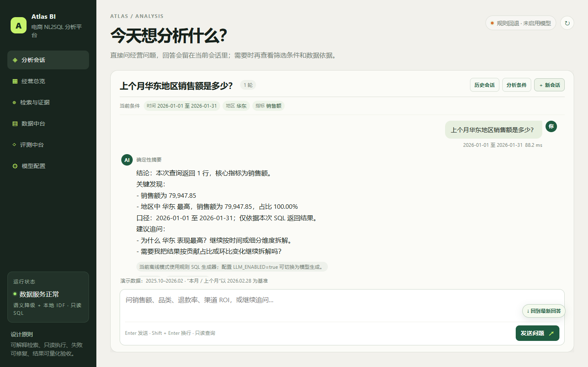
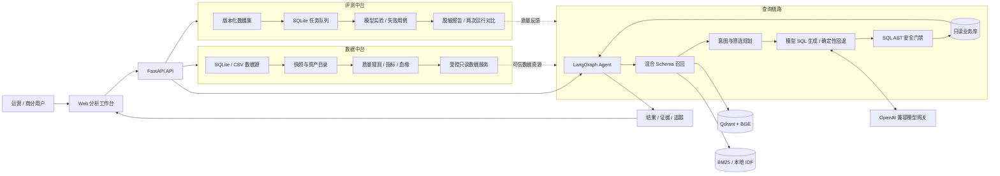
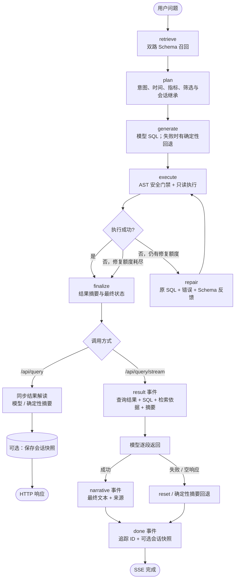
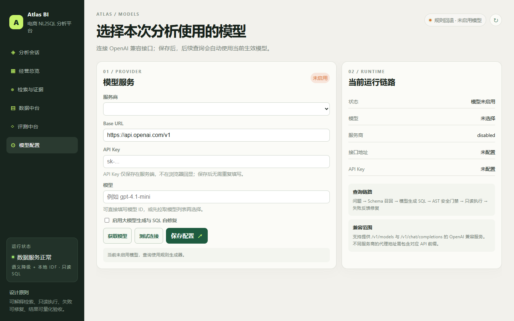
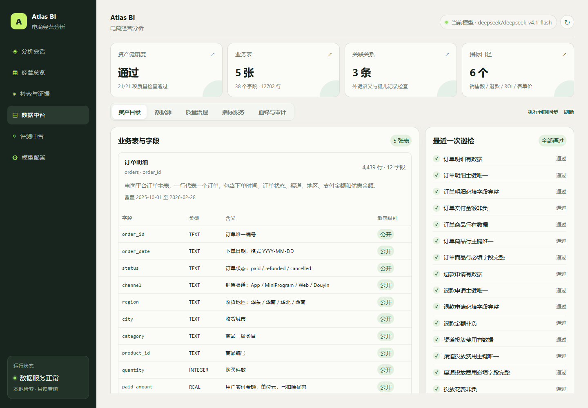
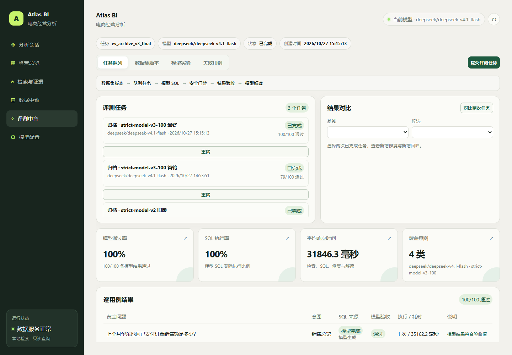

# Atlas BI｜电商 NL2SQL 智能分析平台

**用中文问经营数据，系统生成只读 SQL，再把结果解释清楚。**

Atlas BI 是一个电商经营分析问答项目，业务数据覆盖订单、商品、退款、投放和客户画像。用户直接用中文提问，系统先找出相关表，再规划时间、指标和筛选条件，让模型生成 SQL。SQL 会经过 sqlglot 安全校验，再以只读方式执行；失败时把错误反馈给模型，在限定次数内修复。结果先返回，模型再基于已经跑出来的数据写解释。项目还带数据中台和评测中台：前者管理数据源、快照、质量、血缘和指标，后者管理数据集、实验、队列、重试和失败用例。

[](https://github.com/sun-sh/atlas-bi-nl2sql/actions/workflows/ci.yml)




工作台把分析结论、SQL、明细和检索依据放在同一条对话里。

[本地运行](#本地运行) · [Agent 怎么工作](#agent-怎么工作) · [模型评测](#模型评测) · [评测报告](docs/evaluations/holdout-2026-11-03.json)

## 这个项目做什么

| 维度 | 它能做什么 |
| --- | --- |
| 适合谁 | 电商运营、商业分析、数据支持和业务管理团队 |
| 分析什么 | 销售额、品类、退款率、ROI、客单价、趋势和渠道结构 |
| 一次查询会经过 | 可答性判定 → 双路 Schema 召回 → 意图规划 → 模型生成 SQL → AST 门禁 → 只读执行 → 有限修复 → 解读事实校验 |
| 怎么用 | Web 工作台、FastAPI 查询接口、只读数据服务、OpenAPI 和 OpenAI 兼容模型接口 |
| 数据侧 | SQLite/CSV 接入、快照、资产目录、质量规则、指标口径、字段血缘和审计；兼容 SQLite 可切换为当前分析库 |
| 评测侧 | SQL 结果等价验收、解读事实校验、范围/自然语言/检索消融、数据集版本、实验、队列、取消重试和失败回流 |
| 会话 | 最多 20 轮、7 天过期；新问题里的条件优先，缺失的条件按需继承 |
| 运行观测 | `/api/metrics` 进程内延迟摘要、可选 `X-Admin-Token` 运营门禁、本地 HTTP 压测脚本 |

## 系统架构

查询 Agent 负责回答，数据中台管理数据来源和质量，评测中台记录模型改动。三部分共用同一个 FastAPI 进程和本地 SQLite，没有拆成微服务。



### Agent 怎么工作

这里的 Agent 没有让模型自由选工具。节点、工具和修复次数都是固定的：模型负责生成 SQL、根据错误修 SQL、基于已经执行的结果写结论。它不能改写已执行的行、SQL 或证据，也不能自己增加循环次数。



| 维度 | 实现 |
| --- | --- |
| 控制方式 | 固定节点 `retrieve → plan → generate → execute → finalize`；只有失败才进入 `execute → repair → execute`，次数有上限 |
| 可用工具 | Schema 检索、模型接口、SQL AST 门禁、只读数据库和会话存储；模型不能自己加工具 |
| 模型负责什么 | 生成 SQL、结合错误修 SQL、基于确定性摘要写结论；不能改已经执行的行、SQL 或证据 |
| 什么时候修 | 首次空 SQL 重试一次；AST 校验或执行错误进入修复；全空聚合也算失败；默认最多修 2 次 |
| 结果解读 | 空响应或截断时按 `1800 → 3600` token 重试一次；运行时失败会回退确定性摘要，严格评测则判失败 |
| 记忆范围 | 只保存当前会话的短期上下文；最多 20 轮、7 天过期，不做跨会话用户画像 |
| 评测口径 | `allow_rule_fallback=False`；规则 SQL 和摘要回退都不算模型通过 |

## 主要功能

| 模块 | 实现 |
| --- | --- |
| 可答性判定 | 模糊问题先要求补充指标；因果问题只提供可查询的拆解方向；写操作、敏感字段和域外请求在生成 SQL 前拒绝；澄清和拒答不生成伪造查询计划 |
| 解读事实校验 | 数字必须来自确定性摘要；非榜首不能写成最高；趋势方向不能与摘要相反；失败时回退确定性摘要 |
| 数据源启用 | 同步后的五表兼容 SQLite 可切换为当前分析库；CSV 和结构不兼容来源只进入数据服务/治理，不冒充 NL2SQL 数据源 |
| 运行观测 | `/api/metrics` 暴露进程内请求数、错误数、P50/P95/Max；带管理令牌的运营接口与本地 HTTP 压测脚本可用于回归 |
| 检索验证 | 12 条标注集比较纯词法、纯语义和已发布的 0.56/0.44 融合方案，同时报告 Top-1、MRR 和完整表召回 |
| 语言变体验证 | 15 条独立自然语言问法逐条检查范围、意图、指标、表召回和真实执行行；8 条应回答，7 条应澄清 |
| Schema 召回 | BGE + Qdrant 语义检索与 Elasticsearch BM25 / 本地 IDF 双路召回，最终得分 `0.56 × semantic + 0.44 × lexical` |
| SQL 安全 | sqlglot AST、单条 SELECT、表/函数白名单、拒绝 `SELECT *`、敏感字段拦截、只读连接和结果行数限制 |
| 流式结果 | SSE 先推送查询结果、SQL、检索依据和确定性摘要，再流式生成模型结论；失败时用 `reset` 换成完整摘要 |
| 数据中台 | SQLite/CSV 多源注册，支持快照和入库两种同步方式，另有资产目录、质量规则、指标口径、字段血缘、只读服务和审计 |
| 评测中台 | 数据集版本、模型实验、优先级队列、取消与重试、1–3 个隔离进程、任务对比和失败用例回流 |
| 会话与追踪 | 20 轮 / 7 天短期上下文；每次查询保留计划、召回证据、SQL、尝试记录、告警和 `trace_id` |

## 接入模型

在 `/models` 页面填 OpenAI 兼容的 Base URL 和 API Key，可以拉模型列表、测试连接、保存并启用。配置写在 Git 忽略的 `data/model_config.json`，也可以用 `ATLAS_MODEL_CONFIG_PATH` 换位置。读取配置时不会返回 API Key，只返回 Base URL、模型名和是否已经保存 Key。

| 接口 | 用途 |
| --- | --- |
| `GET /api/model/config` | 获取模型配置；API Key 不回显，Base URL 可见 |
| `PUT /api/model/config` | 保存服务端配置；API Key 留空表示保留原值 |
| `POST /api/model/models` | 拉取可用模型 |
| `POST /api/model/test` | 验证端点、密钥与模型 |



## 模型评测

`strict-model-v3-100` 有 100 条固定用例，最多产生 111 个查询轮次，覆盖时间、地区、渠道、品类、销售额、销量、退款、ROI、趋势、组合筛选和连续追问。每条用例用单独维护的只读基准 SQL 核对行数、维度、数值、排序和业务别名。评测关闭规则回退，模型没有生成 SQL、SQL 执行失败或没有完成结果解读，都不算通过。

| 阶段 | 通过 | SQL 执行率 | 模型完成率 | 平均耗时 |
| --- | ---: | ---: | ---: | ---: |
| 首轮 | **79/100** | 100% | 88% | 32,545.6 ms |
| 修正后复跑 | **100/100** | 100% | 100% | 31,846.3 ms |

首轮失败的 21 条里，12 条是模型解读没有完成，9 条是结果口径不对。调整 SQL 指令、业务口径、空值处理、解读重试和验收逻辑后，同一套题复跑到了 100/100，修复 21 条，回归 0 条。这 21 条由评测驱动的修改解决，不等于运行时自愈。当前严格判分还会校验解读是否引用了摘要外数值、是否把非榜首写成最高、趋势方向是否与摘要一致。

运行时 SQL 自愈在首轮为 1/1，最终轮为 2/2。最终轮使用 3 个隔离进程和 `deepseek/deepseek-v4.1-flash`。报告见 [首轮](docs/evaluations/evaluation-v3-100-initial-2026-10-27.json) 和 [最终轮](docs/evaluations/evaluation-v3-100-2026-10-27.json)。

### 留出集

`strict-model-v3-holdout-30` 有 30 条不参与调参的用例，覆盖 4 类意图、7 种指标、组合筛选、日趋势和 2 条连续追问。用 `deepseek/deepseek-v4.1-flash` 在线运行后，28/30 通过；其中 4 条触发自愈，2 条成功，剩下 2 条重试后仍然超时。评测没有用规则 SQL 或确定性摘要补位，报告见 [留出集 JSON](docs/evaluations/holdout-2026-11-03.json)。

两套评测集都限定在固定电商数据和业务口径内，不代表开放域泛化。

另有 7 条不调用模型的 `scope-guard-v1` 范围评测，覆盖模糊业务问题、因果问题、写操作、敏感字段和域外请求，当前 **7/7 在生成 SQL 前正确澄清或拒绝**，报告见 [范围评测 JSON](docs/evaluations/scope-guard-2026-11-05.json)。这验证的是“不该答时不要硬答”，不是业务查询准确率。

### 自然语言与检索验证

2026-11-06 的 `natural-language-holdout-v1` 使用 15 条未写进调参集的自然问法，逐条校验实际结果：8 条可回答必须命中预期意图、指标、表和真实数据行，7 条能力不完整或口径不清的问题必须停下并要求澄清。当前 **15/15 全部通过**；这是确定性规则链路加真实 SQLite 执行的证据，不是在线模型准确率。报告见 [自然语言评测 JSON](docs/evaluations/natural-language-holdout-2026-11-06.json)。

同一日期运行的 `retrieval-ablation-v1` 在 12 条标注问法上比较三种方案。已发布的 `0.56/0.44` 混合检索 **Top-1 91.7%、MRR 0.9583、完整表召回@4 100%**；纯词法完整召回也是 100%，说明这个只有 5 张表的小集合并不能证明混合检索全面更优。报告保留每种方案明细，见 [检索消融 JSON](docs/evaluations/retrieval-ablation-2026-11-06.json)。

本地 HTTP 冒烟压测以模型关闭、固定种子 SQLite 和规则 SQL 为前提：20 个请求、并发 4，20/20 成功，P50 55.7 ms、P95 158.6 ms、约 15.56 req/s。它只证明当前机器上 HTTP 与只读 SQL 路径可承受这一小规模请求，不代表 LLM 延迟、集群容量或生产 SLA，见 [HTTP 压测 JSON](docs/evaluations/http-loadtest-2026-11-06.json)。

## 数据中台

数据中台把项目里的 SQLite/CSV 数据接进来，记录数据结构、质量和来源：

- 数据源注册，支持快照和入库两种同步方式，并在函数层区分查看者、分析师和管理员权限。
- 保存快照和资产目录；同步时按源表字段生成血缘，并维护 5 个指标口径和 6 条质量规则。
- 提供到期同步入口、只读数据服务、操作审计和独立的数据资产巡检页。
- 内置业务库有 `orders`、`order_items`、`refunds`、`marketing_spend` 和 `customers` 五张表，数据范围是 2025-10 到 2026-02。

默认单工作区、本地管理员；目前没有 SSO、多租户隔离和集群调度。



## 评测中台

评测中台把一次模型运行当成任务来管理：

- 数据集版本、实验假设和失败用例都存在 SQLite。
- 队列按优先级原子领取，同一时间只跑一条评测；一条任务内部可以开 1–3 个隔离模型进程。
- 可以看到运行进度，支持取消、重试、脱敏报告、逐用例结果和两次运行对比。
- 提交后由 FastAPI `BackgroundTasks` 执行，也可以手动领取排队任务。当前没有常驻分布式后台进程；服务重启后排队记录还在，但要重新领取任务才会继续跑。



## 查询与修复

查询由 LangGraph 串起来，安全限制和资源预算放在 `app/nl2sql/harness.py`。它负责生成 `RunContext` 并执行 SQL 策略：

- 只允许单条 `SELECT`；递归 CTE、`CROSS JOIN`、超过 3 个 JOIN 和投影里的 `SELECT *` 都直接拒绝，CTE 里的 `*` 也会检查。
- SQLite 查询受 `QUERY_TIMEOUT_SECONDS` 限制，默认 5 秒；最多读 `MAX_RESULT_ROWS + 1` 行判断截断。
- 每次查询都会返回 `run_context`，包含 `trace_id`、策略版本、修复次数、结果行数上限和超时配置。
- 查询过程中可以停止分析：浏览器中止 SSE，同时调用 `POST /api/query/cancel/{trace_id}`，服务端中断 SQLite 查询和后续节点。

模型输出不会直接信任。失败后只按固定预算重试，不会无限循环，也不会用规则 SQL 冒充模型结果：

1. **生成阶段**：第一次没生成 SQL 时让模型重试一次；Qwen 系列在生成 SQL 和写解读时关闭思考输出。
2. **执行阶段**：SQL 校验失败、字段不存在、语法或执行报错、聚合结果全空，都会进入 `repair`，默认最多修 2 次。
3. **解读阶段**：空响应或被截断时，把 token 上限从 `1800` 提到 `3600` 再试一次；仍失败就用确定性摘要兜底，评测里算失败。
4. **安全边界**：原始 SQL、修复 SQL 和规则 SQL 都经过同一道 AST 门禁。

能自动修的是有明确错误信号的 SQL。查询能跑但业务口径算错时，只能靠业务约束、独立验收或人工发现。

## 流式返回

`POST /api/query/stream` 使用 Server-Sent Events。标准事件顺序为：

```text
起点：start → status* → result → [thinking] → (delta* | reset?) → narrative → done
用户中断：可在 status / result / narrative 阶段返回 cancelled
```

- `start`：开始本轮回复。
- `status`：推送召回、规划、SQL 生成、执行、修复和整理状态。
- `result`：SQL 已执行完成，先返回查询结果、SQL、检索依据和首屏确定性摘要。
- `thinking` / `delta`：模型开始写结论，以及随后逐段返回的文字。
- `reset`：流中途失败时，用确定性摘要替换不完整草稿。
- `narrative`：最终结论文本和 `model` / `digest` 来源。
- `done`：本轮完成；有 `session_id` 时返回已持久化会话快照。
- `cancelled`：用户停止分析或请求被中断；浏览器保留已经收到的可信结果，不再等待后续叙述。

```bash
curl -N -X POST http://127.0.0.1:8000/api/query/stream \
  -H 'Content-Type: application/json' \
  -H 'Accept: text/event-stream' \
  -d '{"question":"上个月各渠道ROI","session_id":null}'
```

前端用 `fetch` 和 `ReadableStream` 读取 POST 响应。查询结果先进入当前这条 AI 回复，SQL、明细和依据按需展开；模型文字随后用 `delta` 逐段追加。用户往上翻时不会强制滚到底。

## API

| 接口 | 说明 |
| --- | --- |
| `GET /api/health` | 当前分析库、检索后端、模型状态与修复配置 |
| `GET /api/metrics` | 进程内请求数、错误率和 P50/P95/Max 延迟 |
| `GET /api/overview` | 经营总览指标 |
| `GET /api/examples` | 获取工作台示例问题 |
| `POST /api/query` | 同步执行完整 NL2SQL 查询 |
| `POST /api/query/stream` | SSE 流式查询与结果解读 |
| `POST /api/query/cancel/{trace_id}` | 请求停止运行中的查询 |
| `GET/POST /api/sessions` | 列出或创建会话 |
| `GET/DELETE /api/sessions/{id}` | 恢复或删除会话 |
| `GET /api/data-assets` | 固定业务域的数据资产巡检 |
| `GET /api/data-platform` | 数据中台概览、质量、血缘和审计 |
| `GET/POST /api/data-platform/workspaces` | 工作区列表与创建 |
| `GET/POST /api/data-platform/sources` | 数据源列表与注册 |
| `POST /api/data-platform/sources/{id}/sync` | 执行快照或入库同步 |
| `POST /api/data-platform/sources/{id}/activate` | 将兼容 SQLite 设为当前 NL2SQL 分析库 |
| `GET/POST /api/data-platform/metrics` | 指标目录 |
| `GET/POST /api/data-platform/quality-rules` | 质量规则 |
| `POST /api/data-platform/sources/{id}/quality` | 执行质量巡检 |
| `GET /api/data-platform/data-service` | 受控只读数据服务 |
| `POST /api/data-platform/scheduler/run` | 手动执行到期同步 |
| `GET/POST /api/evaluation/datasets` | 评测数据集版本 |
| `GET/POST /api/evaluation/experiments` | 评测实验 |
| `GET/POST /api/evaluation/feedback` | 失败用例回流 |
| `GET/POST /api/evaluation/tasks` | 查看或提交评测任务 |
| `GET /api/evaluation/tasks/{id}` | 任务进度与报告 |
| `POST /api/evaluation/tasks/{id}/cancel` | 取消任务 |
| `POST /api/evaluation/tasks/{id}/retry` | 重试已经结束的任务 |
| `POST /api/evaluation/queue/claim` | 手动领取一个排队任务 |
| `GET /api/evaluation/compare` | 对比两次运行 |
| `GET /api/evaluation` | 同步跑一次评测，仅保留作兼容入口 |
| `GET /docs` | OpenAPI 交互文档 |

同步查询返回计划、召回结果、SQL、数据、尝试记录、告警、`trace_id` 和解读。`narrative.mode` 标明解读来自模型还是确定性摘要。带会话的查询还会返回 `session_id` 和更新后的快照，`plan.inherited` 列出继承了哪些条件。评测任务走 `POST /api/evaluation/tasks`；`GET /api/evaluation` 只用于临时调试。

## 怎么验证

```bash
python -m pip install -r requirements-dev.txt
python -m pytest -q
python -m app.evaluation.run
python -m app.evaluation.run --suite scope --min-hit-rate 100
python -m app.evaluation.run --suite retrieval --min-hit-rate 100
python -m app.evaluation.run --suite natural --min-hit-rate 100
node --check app/static/app.js
```

`pytest` 会关闭在线模型和 BGE 下载，用本地数据和受控的模型响应测试 API、SQL 门禁、修复、会话、数据中台和评测任务。当前 **133 项测试全部通过**。CI 在 Python 3.12、`LLM_ENABLED=false`、`USE_BGE=false` 下运行测试和确定性质量门禁，不产生在线模型分数；`scope`、`retrieval`、`natural` 三套门禁不依赖模型 Key。在线模型评测需要配置 Key 和 API，结果会随模型、网络和配置变化。

## 本地运行

需要 Python 3.10+。CI 用 Python 3.12，当前开发环境是 Python 3.13。

```bash
python -m pip install -r requirements.txt
python -m app.nl2sql.seed
python -m uvicorn app.api.main:app --reload --port 8000
```

Windows 可以直接运行 `run.ps1`，macOS / Linux 用 `./run.sh`。

| 页面 | 地址 |
| --- | --- |
| 分析会话 | http://127.0.0.1:8000/workspace |
| 经营总览 | http://127.0.0.1:8000/overview |
| 检索与证据 | http://127.0.0.1:8000/evidence |
| 数据中台 | http://127.0.0.1:8000/data-assets |
| 评测中台 | http://127.0.0.1:8000/evaluation |
| 模型配置 | http://127.0.0.1:8000/models |
| OpenAPI 文档 | http://127.0.0.1:8000/docs |

默认 `USE_BGE=true`，第一次初始化检索器时会下载 BGE 模型。Qdrant 默认用内存模式，并重建 5 张表的向量索引；设置 `QDRANT_URL` 可以连远端 Qdrant，设置 `ELASTICSEARCH_URL` 可以启用 Elasticsearch BM25。

## 配置

复制 `.env.example` 为 `.env`：

| 变量 | 默认值 | 说明 |
| --- | --- | --- |
| `LLM_ENABLED` | `false` | 启用模型 SQL 生成与结果解读 |
| `LLM_PROVIDER` | `openai` | 服务商标识，也可在 `/models` 中配置 |
| `LLM_BASE_URL` | `https://api.openai.com/v1` | OpenAI 兼容接口 |
| `OPENAI_API_KEY` | 空 | 模型密钥 |
| `LLM_MODEL` | `gpt-4.1-mini` | 默认模型 |
| `USE_BGE` | `true` | 启用本地语义检索 |
| `EMBEDDING_MODEL` | `BAAI/bge-small-zh-v1.5` | 本地向量模型 |
| `QDRANT_URL` | 空 | 远端 Qdrant；空值使用内存模式 |
| `ELASTICSEARCH_URL` | 空 | Elasticsearch；空值使用本地 IDF |
| `MAX_REPAIR_ATTEMPTS` | `2` | SQL 修复上限 |
| `MAX_RESULT_ROWS` | `200` | 结果返回上限 |
| `QUERY_TIMEOUT_SECONDS` | `5` | SQLite 查询执行时间上限 |
| `ATLAS_SESSION_DB_PATH` | `data/sessions.db` | 短期会话存储路径 |
| `ATLAS_EVALUATION_DB_PATH` | `data/evaluation_tasks.db` | 评测任务、数据集、实验和失败用例存储路径 |
| `ATLAS_DATA_PLATFORM_DB_PATH` | `data/data_platform.db` | 数据中台元数据与审计存储路径 |
| `ATLAS_PLATFORM_WAREHOUSE_DB_PATH` | `data/platform_warehouse.db` | 数据中台快照/入库的本地仓储路径 |
| `ATLAS_MODEL_CONFIG_PATH` | `data/model_config.json` | 服务端模型配置；不会返回 API Key |
| `ATLAS_DISABLE_MODEL` | `0` | 设为 `1` 时强制禁用模型，便于离线验证 |
| `ATLAS_ADMIN_API_TOKEN` | 空 | 设置后，数据源、指标、评测、模型探测等运营写接口要求 `X-Admin-Token`；SQL 查询路由不受影响 |
| `ATLAS_WORKSPACE_ID` | `default` | 当前查询链路使用的工作区；启用数据源后从该工作区解析分析库 |

## 目录结构

```text
app/
  api/              # FastAPI 接口、数据中台与评测任务 API
  evaluation/       # 模型评测命令入口
  nl2sql/           # Agent、数据中台、评测任务、检索与 SQL 执行
  static/           # 工作台前端资源
data/               # 本地数据库、会话与模型配置（不入库）
docs/
  images/           # 页面截图
  evaluations/      # 回归快照、留出集、范围判定与旧版排查报告
  EVALUATION.md     # 回归集、严格口径、数据集、实验与任务说明
  *.md              # 架构、运行和评测说明
tests/              # 自动化测试
```

## 边界

- 当前使用固定电商数据和固定业务口径，换成其他业务需要补 Schema、业务规则和评测用例。
- 可答性判定以规则为主，覆盖常见澄清、写操作、敏感字段和域外请求；它会减少硬答，但不能替代完整的权限系统和人工复核。
- 数据中台是单工作区、本地管理员，只有函数级角色检查；`X-Admin-Token` 只是可选的共享部署门禁，没有 SSO、多租户隔离、用户级授权和生产数据集群。
- CSV 单表入库不能切换成 NL2SQL 分析库；只有包含固定五表契约的 SQLite 才能被启用为查询数据源。
- `/api/metrics` 是单进程内存窗口，进程重启即清零，也不包含网关、数据库连接池或模型供应商侧指标；HTTP 压测关闭模型，不能当作 LLM 容量结论。
- 评测中台使用 SQLite 队列和单执行槽，没有跨组织标注、分布式后台进程或线上流量评测。

## 文档

- [架构设计](docs/ARCHITECTURE.md)：组件边界、Agent 状态机、分析库切换、运行指标和失败处理。
- [运行手册](docs/OPERATIONS.md)：启动、健康检查、管理令牌、分析库启用、压测、平台存储与故障定位。
- [评测说明](docs/EVALUATION.md)：严格模型评测、自然语言变体、检索消融、HTTP 压测、数据集和任务队列。
- [面试准备](docs/INTERVIEW.md)：项目讲解顺序、常见追问、已验证能力和事实边界。
- [安全策略](SECURITY.md)：SQL 门禁、密钥管理与报告流程。
- [贡献指南](CONTRIBUTING.md)：开发流程、测试要求与提交检查。

## 许可证

MIT，见 [LICENSE](LICENSE)。
