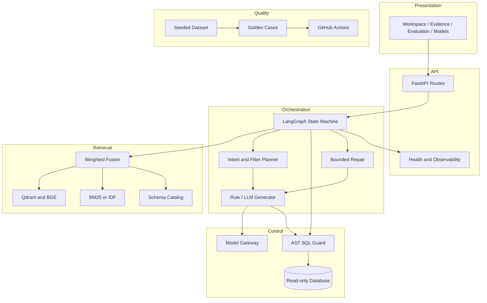
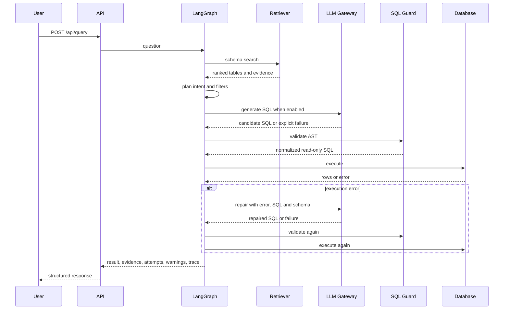

# Architecture

## Overview

Atlas BI is an NL2SQL analytics platform built around four bounded concerns:

1. **Interaction layer** - FastAPI routes and a static single-page workspace.
2. **Reasoning layer** - schema retrieval, query planning, SQL generation and bounded repair orchestration.
3. **Control layer** - AST validation, read-only execution, model configuration and runtime policy.
4. **Quality layer** - deterministic fixtures, golden cases and CI gates.

All rule-generated, model-generated and repaired SQL passes through the same validator before execution.

## Component diagram

## Request sequence

## Runtime state

The LangGraph state carries the question, trace ID, timer, schema hits, plan, generated SQL, execution result, warnings and attempt history. Each attempt records status, SQL, error and elapsed time. A result is finalized only after a successful execution or exhaustion of the configured repair budget.

## Retrieval strategy

- Query and schema text are tokenized for Chinese bigrams and identifier terms.
- Semantic retrieval uses `BAAI/bge-small-zh-v1.5` embeddings.
- Qdrant stores vectors in memory by default; a remote endpoint can be supplied.
- Lexical retrieval uses Elasticsearch BM25 when reachable, otherwise local IDF scoring.
- Final scoring is `0.56 * semantic + 0.44 * lexical`, with evidence preserved in the response.

## Failure model

| Failure | Behavior | Visible outcome |
| --- | --- | --- |
| Model disabled or unavailable | Fall back to rule SQL | `mode=rule`, warning with reason when applicable |
| Model returns empty content | Fall back to rule SQL | Warning records empty response |
| Generated SQL fails validation | Enter repair path | Failed attempt with normalized error |
| Execution fails | Repair with error context | Attempt history preserved |
| Repair budget exhausted | Finalize without a successful result | Warning and trace contain all attempts |
| Retrieval adapter unavailable | Degrade to local IDF or no semantic signal | Health endpoint reports active backend |

## Extension points

- Add a table by updating the schema catalog, seed fixture and golden cases.
- Add a model provider through an OpenAI-compatible endpoint; orchestration remains unchanged.
- Add a database adapter behind the execution boundary while retaining the AST validator contract.
- Add authorization context to the schema catalog and validator before connecting multiple tenants.
- Export trace and attempt records to an observability backend without changing the response model.
