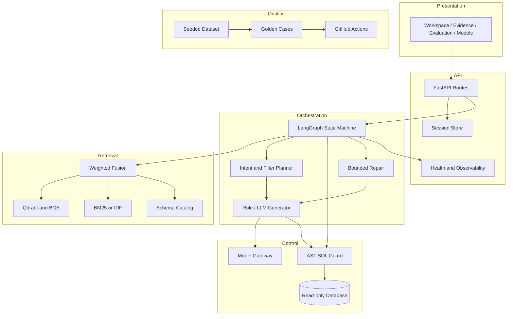
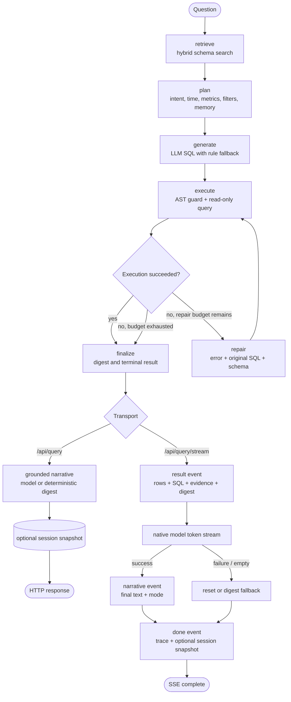
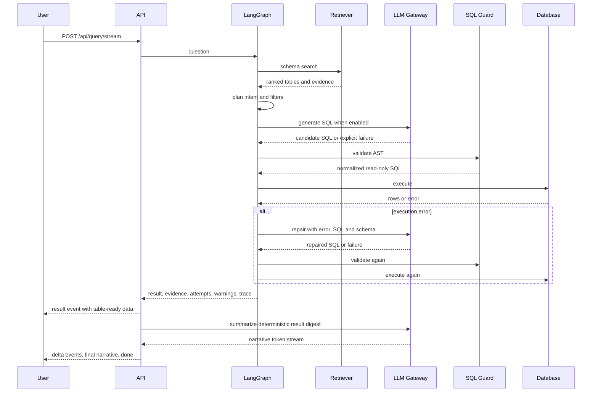

# Architecture

## Overview

Atlas BI is an NL2SQL analytics platform built around four bounded concerns:

1. **Interaction layer** - FastAPI routes, a static single-page workspace and a session-level analysis thread.
2. **Reasoning layer** - schema retrieval, query planning, SQL generation and bounded repair orchestration.
3. **Control layer** - AST validation, read-only execution, model configuration and runtime policy.
4. **Quality layer** - deterministic fixtures, golden cases and CI gates.

Session memory is deliberately bounded: SQLite-backed short-term state, at most 20 turns per session, expiring after 7 days. It stores structured query context, not a cross-session user profile.

All rule-generated, model-generated and repaired SQL passes through the same validator before execution. Result narration runs only after a trusted SQL result exists: deterministic digest statistics constrain the prompt, and a model or streaming failure falls back to the same deterministic summary. The model may summarize trusted rows, but it never rewrites SQL, rows or evidence.

## Component diagram

## Agent orchestration

Atlas BI is intentionally a bounded LangGraph workflow, not an autonomous multi-agent runtime. The model can generate SQL, repair SQL and write a grounded narrative, but it cannot choose arbitrary tools, rewrite executed rows or control the loop budget.

The graph has one controlled cycle: execution failure can enter `repair` and return to `execute`, capped by `MAX_REPAIR_ATTEMPTS`. Retrieval, planning, generation, execution and finalization are fixed nodes; AST validation runs inside `execute`. Session memory is explicit short-term context injected into planning and persistence, not an autonomous memory process.

## Request sequence

## Short-term memory

The session store lives in a separate SQLite file (`data/sessions.db` by default) and persists only bounded analysis state. A follow-up inherits missing intent, time range, metrics and filters from the latest turn. Explicit values in the new question take precedence; changing an explicit dimension clears stale filters from the previous turn. Sessions are isolated by ID, capped at 20 turns and pruned after 7 days. No cross-session user profile or long-term preference store is used.

## Runtime state

The LangGraph state carries the question, retrieval question, trace ID, timer, schema hits, plan, generated SQL, execution result, warnings and attempt history. Each attempt records status, SQL, error and elapsed time. A result is finalized only after a successful execution or exhaustion of the configured repair budget. The streaming endpoint runs this graph with narration disabled, emits the trusted result first, then streams a digest-grounded narrative before persisting the completed turn.

## Retrieval strategy

- Query and schema text are tokenized for Chinese bigrams and identifier terms.
- Semantic retrieval uses `BAAI/bge-small-zh-v1.5` embeddings.
- Qdrant stores vectors in memory by default; a remote endpoint can be supplied.
- Lexical retrieval uses Elasticsearch BM25 when reachable, otherwise local IDF scoring.
- Final scoring is `0.56 * semantic + 0.44 * lexical`, with evidence preserved in the response.

## Failure model

| Failure | Behavior | Visible outcome |
| --- | --- | --- |
| Model disabled or unavailable | Fall back to rule SQL | `mode=rule`, warning with reason when applicable |
| Model returns empty content | Fall back to rule SQL | Warning records empty response |
| Generated SQL fails validation | Enter repair path | Failed attempt with normalized error |
| Execution fails | Repair with error context | Attempt history preserved |
| Repair budget exhausted | Finalize without a successful result | Warning and trace contain all attempts |
| Narrative model fails or returns empty content | Fall back to deterministic digest narrative | `narrative.mode=digest`, reason recorded in warnings |
| Narrative stream fails after partial text | Reset the client text to the deterministic digest | Final narrative remains complete and persisted |
| Retrieval adapter unavailable | Degrade to local IDF or no semantic signal | Health endpoint reports active backend |

## Extension points

- Add a table by updating the schema catalog, seed fixture and golden cases.
- Add a model provider through an OpenAI-compatible endpoint; orchestration remains unchanged.
- Add a database adapter behind the execution boundary while retaining the AST validator contract.
- Add authorization context to the schema catalog and validator before connecting multiple tenants.
- Export trace and attempt records to an observability backend without changing the response model.
