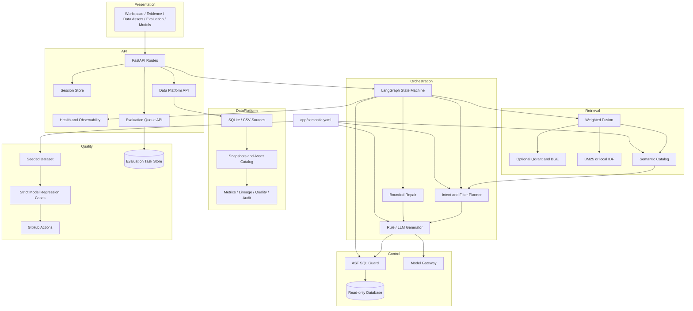
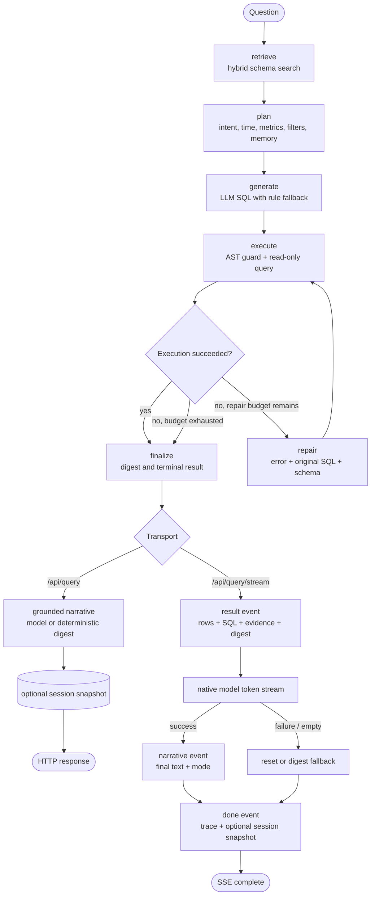
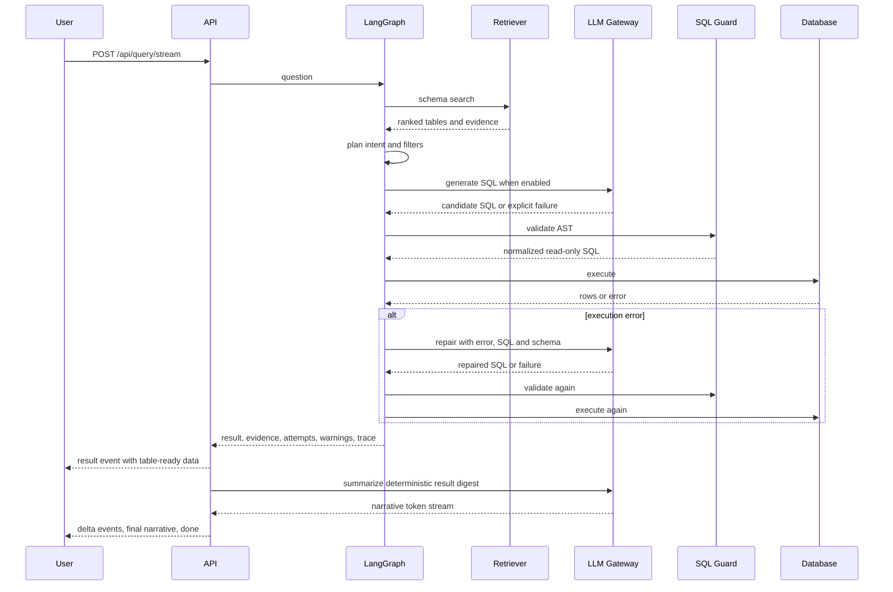

# Architecture

## Overview

Atlas BI has three runnable control planes plus bounded quality guardrails:

1. **Query control plane** - FastAPI routes, the analysis workspace, session context and the bounded LangGraph SQL agent.
2. **Data platform** - SQLite/CSV source registration, snapshots, asset catalog, lineage, quality rules, metrics, read-only data service and audit.
3. **Evaluation platform** - versioned datasets, experiments, a SQLite task queue, isolated model processes, run comparison and bad-case feedback.
4. **Quality guardrails** - independent acceptance SQL, strict model mode, deterministic tests and CI gates.

The business semantic contract lives in `app/semantic.yaml`. It is the single runtime source for table/column metadata, keys and grain, relationships, enums and aliases, time windows, intent terms, required tables, dimensions and metric expressions/filters, including the overview dashboard formulas. `app/nl2sql/semantic.py` renders that YAML into the SQLite seed DDL, schema prompts, rule SQL, result-digest aliases, overview metrics and evaluation constants. Python modules may hold seed rows, SQL assembly and orchestration, but must not maintain a second table/metric/enum catalog.

Session memory is deliberately bounded: SQLite-backed short-term state, at most 20 turns per session, expiring after 7 days. It stores structured query context, not a cross-session user profile.

All rule-generated, model-generated and repaired SQL passes through the same validator before execution. Result narration runs only after a trusted SQL result exists: deterministic digest statistics constrain the prompt, the final text is validated against digest values, ranking and trend direction, and a validation, model or streaming failure falls back to the same deterministic summary. The model may summarize trusted rows, but it never rewrites SQL, rows or evidence.

Before retrieval, a deterministic intent guard decides whether a request is answerable, needs clarification, or must be refused. Write requests, sensitive fields, out-of-domain requests and ambiguous business questions never reach SQL generation. A clarification/refusal produces an explicitly empty plan, not a default sales query. Follow-ups remain answerable when the previous turn already established a metric.

The SQL harness enforces a bounded policy before execution: one SELECT statement, authorized tables/functions, no projection-level stars (including inside CTEs), no recursive CTEs, no CROSS JOIN, at most three JOINs, and a bounded subquery depth. SQLite execution also has a wall-clock progress-handler timeout and fetches only the rows needed to mark truncation.

On the model path, an empty first SQL response triggers one model retry. Validation or execution failures enter the bounded `repair` node; an all-empty aggregate result is also treated as a failure signal. Narration empty/truncated responses receive one retry at a larger token budget, after which production falls back to the deterministic digest while strict evaluation fails the case.

## Component diagram

## Agent orchestration

Atlas BI is intentionally a bounded LangGraph workflow, not an autonomous multi-agent runtime. The model can generate SQL, repair SQL and write a grounded narrative, but it cannot choose arbitrary tools, rewrite executed rows or control the loop budget.

The graph has one controlled cycle: execution failure can enter `repair` and return to `execute`, capped by `MAX_REPAIR_ATTEMPTS`. Retrieval, planning, generation, execution and finalization are fixed nodes; AST validation runs inside `execute`. Session memory is explicit short-term context injected into planning and persistence, not an autonomous memory process.

## Request sequence

## Short-term memory

The session store lives in a separate SQLite file (`data/sessions.db` by default) and persists only bounded analysis state. A follow-up inherits missing intent, time range, metrics and filters from the latest turn. Explicit values in the new question take precedence; changing an explicit dimension clears stale filters from the previous turn. Sessions are isolated by ID, capped at 20 turns and pruned after 7 days. No cross-session user profile or long-term preference store is used.

## Runtime state

The LangGraph state carries the question, retrieval question, trace ID, timer, schema hits, plan, generated SQL, execution result, warnings and attempt history. Each attempt records status, SQL, error and elapsed time. A result is finalized only after a successful execution or exhaustion of the configured repair budget. The streaming endpoint runs this graph with narration disabled, emits the trusted result first, then streams a digest-grounded narrative before persisting the completed turn.

## Retrieval strategy

- The default core installation is lightweight: local IDF/token scoring only. BGE, Qdrant and Elasticsearch live in `requirements-retrieval.txt`; `USE_BGE=false` is the default.
- Query and schema text are tokenized for Chinese bigrams and identifier terms.
- When the optional stack is installed and enabled, semantic retrieval uses `BAAI/bge-small-zh-v1.5` embeddings. Qdrant stores vectors in memory by default; a remote endpoint can be supplied. Existing project-scoped collections/indexes are reused and upserted rather than deleted on startup.
- Lexical retrieval uses Elasticsearch BM25 when reachable, otherwise local IDF scoring. Elasticsearch scores are scoped to one `search()` call rather than stored on the shared retriever.
- Final scoring, when semantic retrieval is active, is `0.56 * semantic + 0.44 * lexical`, with evidence preserved in the response.
- Default SQL generation uses the deterministic business-required tables only. Retrieval is still returned as evidence and can be enabled as a discovery aid, but `ATLAS_RETRIEVAL_SUPPLEMENTS=0` keeps it out of the generation prompt. When set to `1`, at most one top-1 table that is not already required can be added; lower-ranked hits never become schema.
- A frozen colloquial A/B on the five-table demo found no measurable generation gain from one optional retrieval supplement, so retrieval is not presented as a default generation gain.
- The search-only ablation reports Top-1 accuracy, MRR and full recall@4. On the current five-table labelled set, lexical-only also reaches full recall@4, and one sales question still puts the marketing table ahead of orders, so the evidence is a baseline rather than a claim that fusion dominates every alternative.

## Active query database

The data platform stores source metadata and snapshots separately from the query path. `POST /api/data-platform/sources/{id}/activate` is an operator action: it accepts a synced SQLite file or externally configured PostgreSQL/MySQL source that implements the fixed five-table schema contract, verifies the live file or DSN schema, and marks one source active per workspace. CSV sources are intentionally limited to governance and the read-only data service because a single imported table cannot satisfy the semantic layer.

`/api/query`, `/api/query/stream` and `/api/overview` resolve the active query target at request time and pass a dialect-aware read-only target through the LangGraph state. `/api/health` reports the resolved source ID, database filename or external kind, dialect and fallback state. This is a real source switch, not a display-only selector.

`app/nl2sql/sql_engine.py` separates SQL validation from execution adapters. SQLite executes through a read-only file connection; PostgreSQL and MySQL use optional DB-API drivers behind the same validator and bounded result contract. External targets are registered with an explicit read-only DSN and must pass a five-table schema inspection before activation. The project still does not provide connection pooling, per-tenant row filters, replicated failover or automatic external catalog synchronization.

## Operational controls and metrics

All operator mutations on data-platform, evaluation and model-probe routes pass through one optional dependency. When `ATLAS_ADMIN_API_TOKEN` is set, callers must send `X-Admin-Token`; when it is empty, the local demo remains open. Protected operator reads for the data-platform control plane and model configuration use the same gate, while query/session routes stay public because they are the end-user path. This is a single shared operator secret, not user authentication or RBAC.

`app/nl2sql/runtime_metrics.py` keeps a bounded in-process sample window (latest 1000 observations per route). `/api/metrics` exposes count, error count, error rate and P50/P95/max for `query` and `query_stream`. These are process-local diagnostics: restarting the process clears them, and a multi-worker deployment needs external aggregation.

## Harness boundary

`app/nl2sql/harness.py` defines the versioned run contract. `RunContext` records the trace ID, query timeout, repair budget, result-row budget and policy version; it is carried through LangGraph state and returned as `run_context`. The SQL policy is separate from LangGraph so the orchestration layer can be replaced without weakening execution guardrails.

## Failure model

| Failure | Behavior | Visible outcome |
| --- | --- | --- |
| Model disabled or unavailable | Fall back to rule SQL | `mode=rule`, warning with reason when applicable |
| Model returns empty content | Retry once with an explicit empty-SQL prompt; production can then fall back to rule SQL | Warning and generation-retry count recorded |
| Aggregate result is entirely null | Treat as an execution failure and enter repair | Failed attempt and repair history preserved |
| Generated SQL fails validation | Enter repair path | Failed attempt with normalized error |
| Execution fails | Repair with error context | Attempt history preserved |
| Repair budget exhausted | Finalize without a successful result | Warning and trace contain all attempts |
| Narrative model fails or returns empty content | Fall back to deterministic digest narrative | `narrative.mode=digest`, reason recorded in warnings |
| Narrative stream fails after partial text | Reset the client text to the deterministic digest | Final narrative remains complete and persisted |
| Retrieval adapter unavailable | Degrade to local IDF or no semantic signal | Health endpoint reports active backend |

## Evaluation contracts

The strict evaluator separates two denominators:

- `answer_correct`: independent reference-SQL row comparison plus the grounded model narrative. This is the primary business-answer contract.
- `plan-correct`: intent, metric and required-table routing, reported independently so a correct answer is not hidden by a stale plan label and a correct plan cannot mask a wrong answer.

CI-style deterministic suites report the same top-level fields as aliases of their primary invariant; they do not claim a model or an independent plan oracle.

## Extension points

- Add a table or change columns/enums/metric formulas in `app/semantic.yaml`; the SQLite seed DDL, prompts and rule SQL render from it. Add seed rows and strict regression cases separately.
- Add a model provider through an OpenAI-compatible endpoint; orchestration remains unchanged.
- Add a production database adapter/pool behind the execution boundary while retaining the AST validator contract; the current opt-in DB-API adapters do not include pooling or tenant filters.
- Add authorization context to the semantic catalog and validator before connecting multiple tenants.
- Export trace and attempt records to an observability backend without changing the response model.
